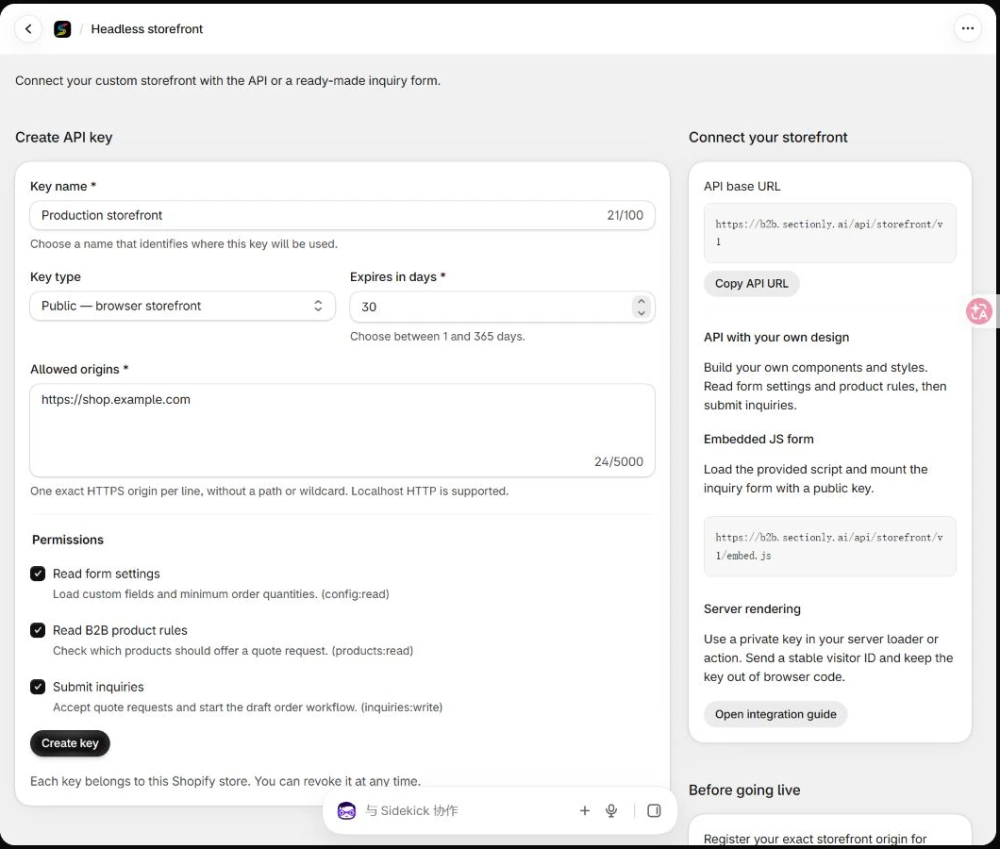
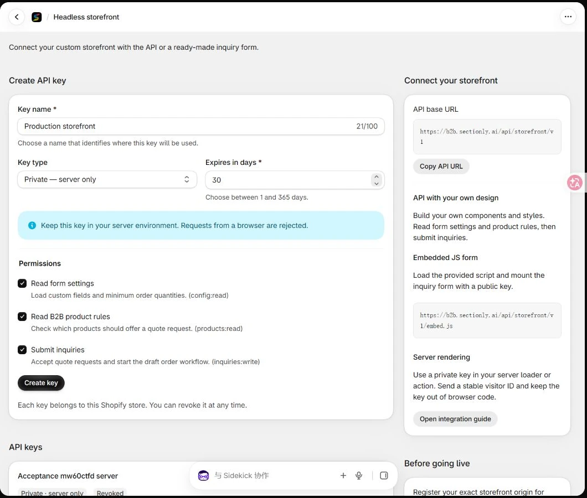

Use Sectionly B2B Wholesale with a custom Shopify storefront. You can build your own design with the API, embed the ready-made inquiry form, or call the API from your server for initial rendering and submission.

<Note>
Inquiries appear in **Shopify admin → Sectionly B2B Wholesale → Inquiries**. Shopify draft orders are created asynchronously and appear under **Orders → Drafts**. If draft creation fails, the inquiry remains available with an error and a retry action.
</Note>

## Before you start

- Install the production Sectionly B2B Wholesale app and confirm that you can open it in Shopify admin.
- Configure B2B products or template rules, minimum order quantities (MOQ), and required custom fields in **Quote Settings**.
- Prepare your real storefront domain, product IDs, and variant IDs. Variants must belong to the corresponding products in the same store.

Your headless storefront must apply the returned display rules to its own price and add-to-cart UI. The embedded form provides the inquiry flow; it does not automatically control your custom product pages, price authorization, or checkout permissions. Enforce purchase restrictions on your storefront's server and checkout flow where needed.

## Create a public browser key

Open **Shopify admin → Apps → Sectionly B2B Wholesale → Headless** and use the **Create API key** form.

<Frame caption="Create a public key with an allowed storefront origin, expiry, and permissions">
  
</Frame>

1. **Key name:** enter a recognizable name, such as `Production storefront`.
2. **Key type:** select **Public — browser storefront**.
3. **Allowed origins:** add each real storefront origin on its own line, such as `https://shop.example.com`. Add the `www` origin separately if you use it.
4. **Expires in days:** choose 1–365 days. Use a short duration for testing and record the expiry of production keys.
5. **Permissions:** select the access you need:
   - **Read form settings** — `config:read`
   - **Read B2B product rules** — `products:read`
   - **Submit inquiries** — `inquiries:write`
6. Click **Create key** and immediately save the complete `sb2b_pk_` key. Its full value is shown only once; the list subsequently shows a prefix.

The complete inquiry widget needs all three permissions. A read-only integration does not need **Submit inquiries**.

Origins must match the scheme, hostname, and port exactly, with no path or wildcard. `https://shop.example.com` and `https://www.shop.example.com` are different origins. Local HTTP origins such as `http://localhost:3000` and `http://127.0.0.1:3000` are supported; use HTTPS in production.

## Create a private server key

For SSR or a server relay, create a separate key with **Key type → Private — server only**. Set its name, expiry, and permissions. A private key does not need a browser origin allowlist.

<Frame caption="Private keys show server-only guidance instead of browser origin fields">
  
</Frame>

After clicking **Create key**, immediately save the complete `sb2b_sk_` key in your server environment or secret manager. If it is lost, create a replacement and revoke the old key.

<Warning>
Keep private keys out of browser JavaScript, HTML, public environment variables, source control, and screenshots. Requests carrying a browser `Origin` header are rejected for private keys. The screenshots show only the setup form, not usable credentials.
</Warning>

## Choose your integration

| Method | Use case | Key |
| --- | --- | --- |
| Embedded JS form | Quickly add SKU selection and inquiry submission | Public |
| API with your own UI | Custom React, Vue, HTML, and CSS | Public for browser requests |
| Server rendering and relay | Render initial HTML or centralize submission | Private, on the server |

The production API base URL is:

```text
https://b2b.sectionly.ai/api/storefront/v1
```

Reviews and B2B use separate keys and request headers. Do not interchange them.

## Embed the ready-made inquiry form

Add this to a product page. Replace the key, Shopify store domain, product, and variant data with values from your storefront data source. Do not reuse the same product ID across every product page.

```html
<div id="b2b-quote"></div>
<script src="https://b2b.sectionly.ai/api/storefront/v1/embed.js"></script>
<script>
  SectionlyB2B.mount({
    target: '#b2b-quote',
    apiBase: 'https://b2b.sectionly.ai/api/storefront/v1',
    publicKey: 'sb2b_pk_REPLACE_WITH_YOUR_PUBLIC_KEY',
    shopDomain: 'YOUR_STORE.myshopify.com',
    product: {
      id: 'YOUR_PRODUCT_ID',
      title: 'Your product title',
      handle: 'your-product-handle',
      variants: [{
        id: 'YOUR_VARIANT_ID', title: 'Blue / Large',
        sku: 'BLUE-L', available: true,
      }],
    },
  }).catch(error => {
    document.querySelector('#b2b-quote').textContent =
      'The quote form is temporarily unavailable. Please try again.';
    console.error(error);
  });
</script>
```

The widget loads custom form fields and MOQ, manages a visitor ID, and retains an operation ID for in-page submission retries. Buyers click **Add SKUs**, choose variants and quantities, save their selection, enter contact and required company details, and submit.

One form is supported per page. The quote list can persist across product pages for the same shop. Use the API for multiple independent forms on one page.

Numeric IDs and Shopify GIDs are accepted. Supply the real variant availability from your storefront data. The server still checks product and variant ownership, active product status, and minimum quantities, and replaces client descriptions with canonical product and variant information.

### Customize the appearance

Load your override stylesheet after `embed.css` and scope it to `.sectionly-b2b-form`. For complete control over field layout, buttons, or interaction, use the API with your own components.

For a site with a restrictive CSP, allow the app domain for scripts, styles, and API connections. Use your site's actual nonce for the inline configuration script when required.

## Use the API with your own styles

Put the following three browser examples in the same frontend ES module or `<script type="module">`, in order: visitor identity, configuration and product reads, and the submission function. Connect `submitInquiry` to your form and add loading, success, and error states.

### Keep a stable visitor ID

Browser requests require `X-Sectionly-Visitor`, a stable random identifier of 16–80 characters. Do not use one hard-coded value for every customer. This example retains the identifier within the current browser tab and falls back to a page-local ID if storage is unavailable.

```javascript
let visitorId;
try {
  visitorId = sessionStorage.getItem('sectionly-visitor') || crypto.randomUUID();
  sessionStorage.setItem('sectionly-visitor', visitorId);
} catch {
  visitorId = crypto.randomUUID();
}
```

### Load form settings and product rules

```javascript
const apiBase = 'https://b2b.sectionly.ai/api/storefront/v1';
const publicKey = 'sb2b_pk_REPLACE_WITH_YOUR_PUBLIC_KEY';
const headers = {
  'X-Sectionly-Key': publicKey,
  'X-Sectionly-Visitor': visitorId,
};

async function readApi(path) {
  const response = await fetch(`${apiBase}${path}`, {
    headers, signal: AbortSignal.timeout(10000),
  });
  const data = await response.json();
  if (!response.ok) throw new Error(data.error || `HTTP ${response.status}`);
  return data;
}

const config = await readApi('/form-config');
const decisions = await readApi(
  '/b2b-products?handles=' + encodeURIComponent('your-product-handle')
);
```

Build the form using the returned custom fields and minimum quantities, and apply the product decisions to your storefront UI. Product lookup accepts at most **500 unique valid handles** per request. Batch large catalogs instead of building an unbounded query.

### Submit an inquiry and retry safely

The quantity `18` below is an example. Use your actual MOQ and include every required custom field returned by `/form-config`. If the merchant requires **Estimated Quantity**, for example, include that field too.

```javascript
// Create these once for one inquiry, outside the retry function.
const operationId = crypto.randomUUID();
const body = JSON.stringify({
  customerName: 'Test Buyer',
  customerEmail: 'buyer@example.com',
  productId: 'YOUR_PRODUCT_ID',
  productHandle: 'your-product-handle',
  lineItems: [{variantId: 'YOUR_VARIANT_ID', quantity: 18}],
  customFields: {'Company Name': 'Example Company'},
  note: 'Please quote delivery to our warehouse',
});

async function submitInquiry() {
  const response = await fetch(`${apiBase}/inquiry`, {
    method: 'POST', credentials: 'omit',
    headers: {
      ...headers,
      'Content-Type': 'application/json',
      'Idempotency-Key': operationId,
    },
    body,
  });
  const data = await response.json();
  if (!response.ok) throw new Error(data.error || `HTTP ${response.status}`);
  return data;
}
```

Success returns HTTP `201` with `{success: true, inquiryId}`. The inquiry is saved first; draft order creation and notifications follow asynchronously. Verify the draft order's status in the app rather than treating inquiry acceptance as proof that a draft already exists.

Use a new `Idempotency-Key` for each new inquiry. After a network failure, timeout, or `5xx`, retry the **same operation ID and unchanged request body**. A successful replay returns the original inquiry ID without starting another draft order workflow. Reusing a successful key with different content returns `409`.

The embedded form keeps its identity for in-page retries. Reloading starts a new form session. If your custom client must recover across reloads, persist the operation ID and immutable request body until the result is known.

Requests are limited to **256 KiB**, **50 products**, and **250 variant rows**. Quantities must be positive integers and their total must fit PostgreSQL's signed integer range. An invalid item rejects the entire inquiry; it is not silently omitted. Multi-product submissions can use `items`, each containing product data and `lineItems`.

## Use server rendering or a server relay

Your server can fetch `/form-config` and `/b2b-products` to render the initial form, then relay submissions through your own backend. Call this helper from a Hydrogen server action, a Next.js server route, or another backend. Read the key from server-only configuration and never return it to the browser.

```javascript
// Server only. Values come from your server configuration/session.
export async function relayInquiry({
  privateKey, visitorSessionId, operationId, validatedPayload,
}) {
  return fetch('https://b2b.sectionly.ai/api/storefront/v1/inquiry', {
    method: 'POST',
    headers: {
      'Content-Type': 'application/json',
      Authorization: `Bearer ${privateKey}`,
      'X-Sectionly-Visitor': visitorSessionId,
      'Idempotency-Key': operationId,
    },
    body: JSON.stringify(validatedPayload),
  });
}
```

Derive `visitorSessionId` from your server session and keep it stable for the visitor. Validate the caller, form data, and request origin on your own relay; apply CSRF protection and rate limits. Fix the upstream API destination instead of accepting arbitrary target URLs from the browser.

Do not forward a browser `Origin` header with private-key requests, or send both `Authorization` and `X-Sectionly-Key`. Preserve the upstream HTTP status, JSON, and `Retry-After` for your frontend. Do not turn all failures into HTTP `200`, or generate a new operation ID automatically after an uncertain network result.

## Verify the merchant workflow

1. Open a real product page and check its B2B display rules and required fields. A quantity below MOQ should produce clear feedback.
2. Submit one clearly marked test inquiry with a reachable test email, company details, and a valid quantity.
3. In **Inquiries**, check the product, variant, quantity, and draft order link. If draft creation fails, review the error and use the retry action.
4. Check the buyer acknowledgement and merchant notification configuration. Provider acceptance does not guarantee inbox delivery.
5. Confirm that **Needs attention** lists the inquiry once. After opening its details and returning home, an unquoted inquiry should remain **Awaiting quote**.
6. Check desktop and mobile layouts, long company and product names, SKU selection, quantity changes, clearing, and repeated clicks. Keep or clean up the test data according to your team's policy.

## Errors and rate limits

| Status | Cause and next step |
| --- | --- |
| `400` | Missing visitor or operation ID, malformed fields, invalid quantity, MOQ failure, or invalid variant |
| `401` | Missing, expired, revoked key, or unavailable store |
| `403` | Origin or permission mismatch, or a private key used in the browser |
| `409` | A successful operation ID reused with different content, or a recent duplicate |
| `413` | Request body exceeds 256 KiB |
| `415` | Submission is not JSON |
| `429` | Visitor or IP quota exceeded; wait for `Retry-After` |
| `503` | Shop authorization, upstream validation, or infrastructure temporarily unavailable; retain the original operation identity |

Each visitor can make **120 reads/minute** and **20 writes/hour**. Public traffic also has IP limits of **600 reads/minute** and **100 writes/hour**. Private SSR traffic does not share one server-IP quota across the whole storefront, but it must still identify visitors correctly.

## Rotate keys and go live

1. Create a replacement before the old key expires, with the necessary permissions and exact production origins.
2. Update and deploy the browser or server configuration, then verify reads and inquiry submission.
3. In **API keys**, click **Revoke** on the old key. Check its name in the confirmation dialog, click **Revoke key**, and confirm its status becomes **Revoked**.
4. After uninstalling and reinstalling the app, create new keys and update the storefront configuration.

Before launch, verify the production domain, real product and variant IDs, required fields, MOQ, mobile layout, safe network retries, and rate-limit messages. Confirm that no `sb2b_sk_` key appears in browser code or page source. Use separate keys for development and production.

See the [complete B2B Headless API contract](https://b2b.sectionly.ai/headless/docs) for additional request and response details.

Updated November 11, 2026. Screenshots use a demonstration store. Replace all example domains, keys, product IDs, and variant IDs with your own values.
