This guide provides a comprehensive walkthrough of using AI functionality to quickly create product option sets, including requirement descriptions, conversational interactions, version management, and configuration saving.

## Accessing the AI Chat Interface

### Navigation Path

<Steps>
<Step title={"Access the App admin dashboard"}>
</Step>
<Step title={"Select \"Sectionly:AI Product Options\""}>
</Step>
<Step title={"Click \"AI Chat\""}>
</Step>
</Steps>

## Core Workflow

### Input Requirement Description

In the chat input field, describe your product option set requirements in natural language. You can use plain text, images, attachments, links, and other formats to assist with explanations.

<Tabs>
<Tab title="Plain Text Example">

**Example Description:**
```
Create a phone case customization option set including material options (silicone, PC hard shell),
patterns (cartoon, minimalist, custom upload), lanyard hole (with or without),
with silicone material having an additional $5 charge
```

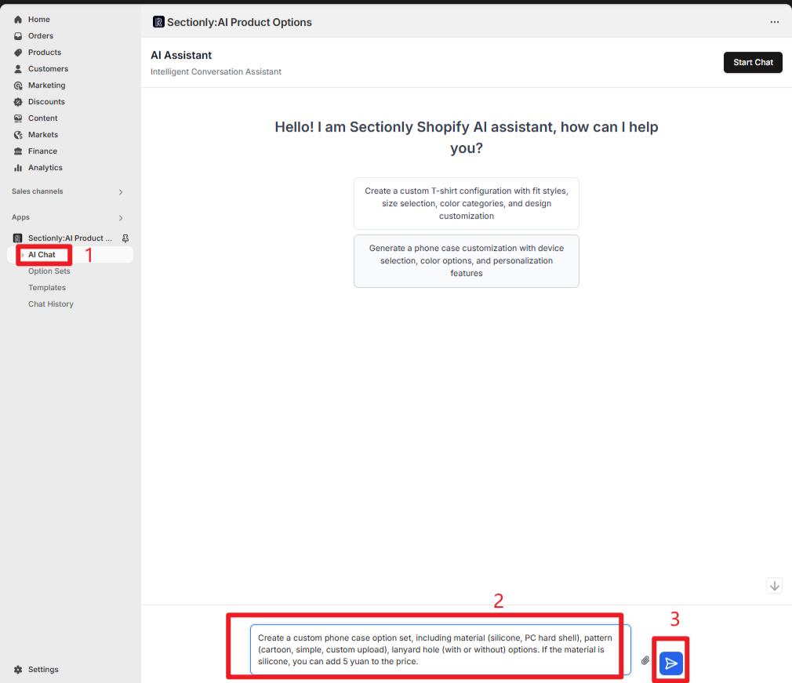

</Tab>
<Tab title="Attachments/Images/Links">

**Multimedia-Assisted Descriptions:**

1. Click the attachment icon next to the input field to upload reference images (such as existing phone case customization examples)
2. Upload documents (Excel files with detailed option rules)
3. Add reference links (product customization page URLs)
4. Images and links can be directly pasted into the input field

<Info>
Multimedia assistance helps AI understand requirements more precisely and improves generation quality.
</Info>

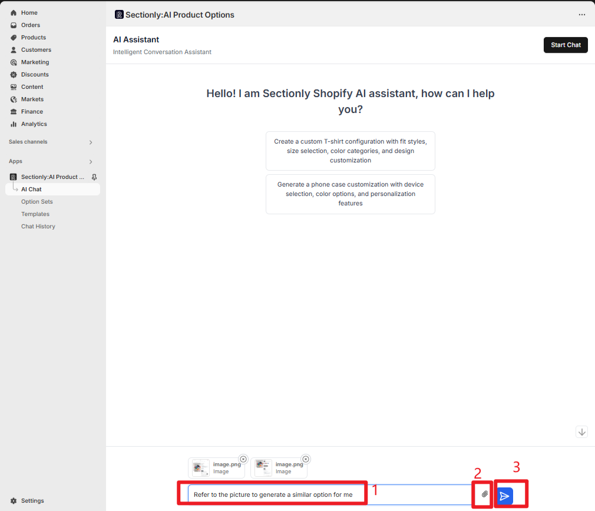

</Tab>
</Tabs>

### Conversational Interaction and Optimization

#### Generation and Preview

<Steps>
<Step title={"After entering requirements, press Enter and AI automatically generates the product option set configuration"}>
</Step>
<Step title={"Left side displays conversation content, showing generation results (including version numbers and configuration overview)"}>
</Step>
<Step title={"Right side preview area presents the frontend effect of the option set (such as option layout and interaction logic)"}>
</Step>
</Steps>

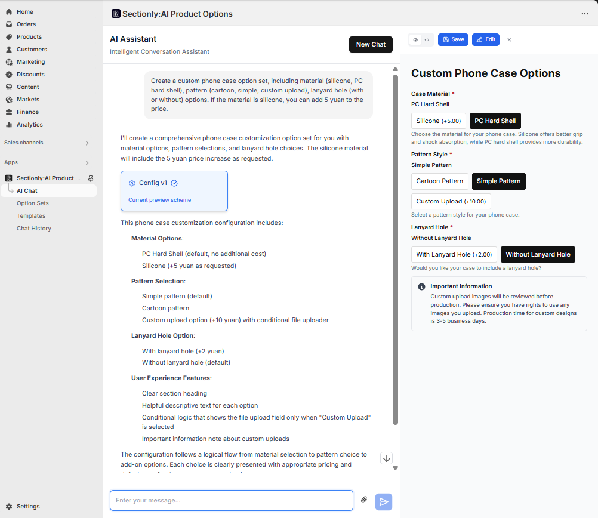

#### Continue Optimization

If you're not satisfied with the generated results, you can provide additional instructions for optimization:

**Optimization Example:**
```
Add 'glow-in-the-dark' material option with $3 surcharge for PC hard shell
```

AI will iteratively generate new configurations based on conversation history, supporting multiple iterations (generating multiple versions like V1, V2).

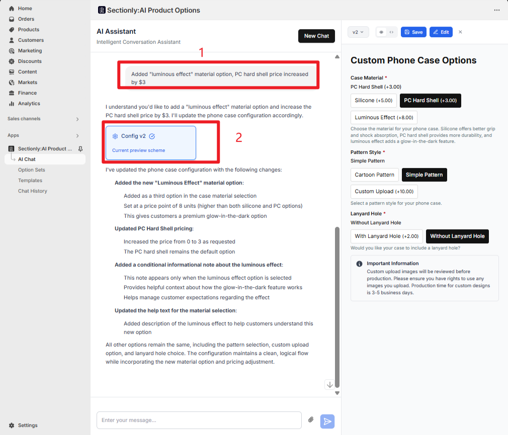

### Version Switching and Comparison

<Tabs>
<Tab title="Left Chat Area Switching">

**How to Operate:**
- The chat area retains all historical version cards
- Click on different versions (`Config v1`/`Config v2`)
- The right preview area will sync to show the corresponding configuration effect
- Easy to compare differences across multiple optimization rounds

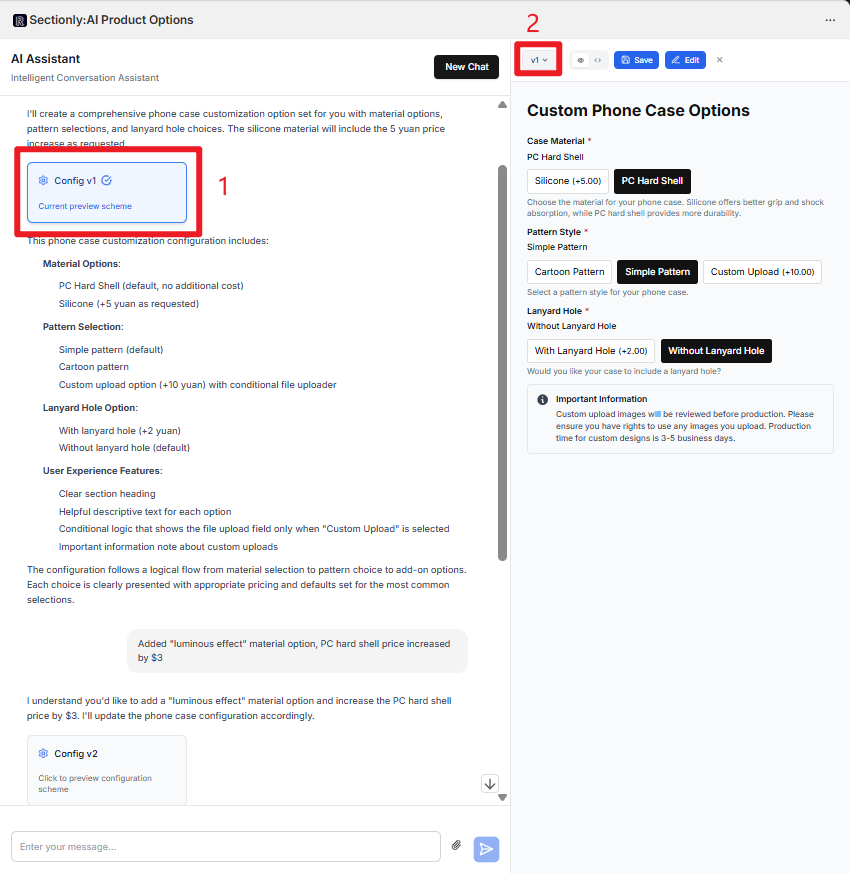

</Tab>
<Tab title="Right Dropdown Switching">

**How to Operate:**
- The top of the right preview area has a version dropdown menu (showing current version, e.g., `v2`)
- Click to expand the version list (including `v1`/`v2`)
- Select the corresponding version to switch preview effects
- Linked with left chat area switching functionality, bidirectional synchronized display status

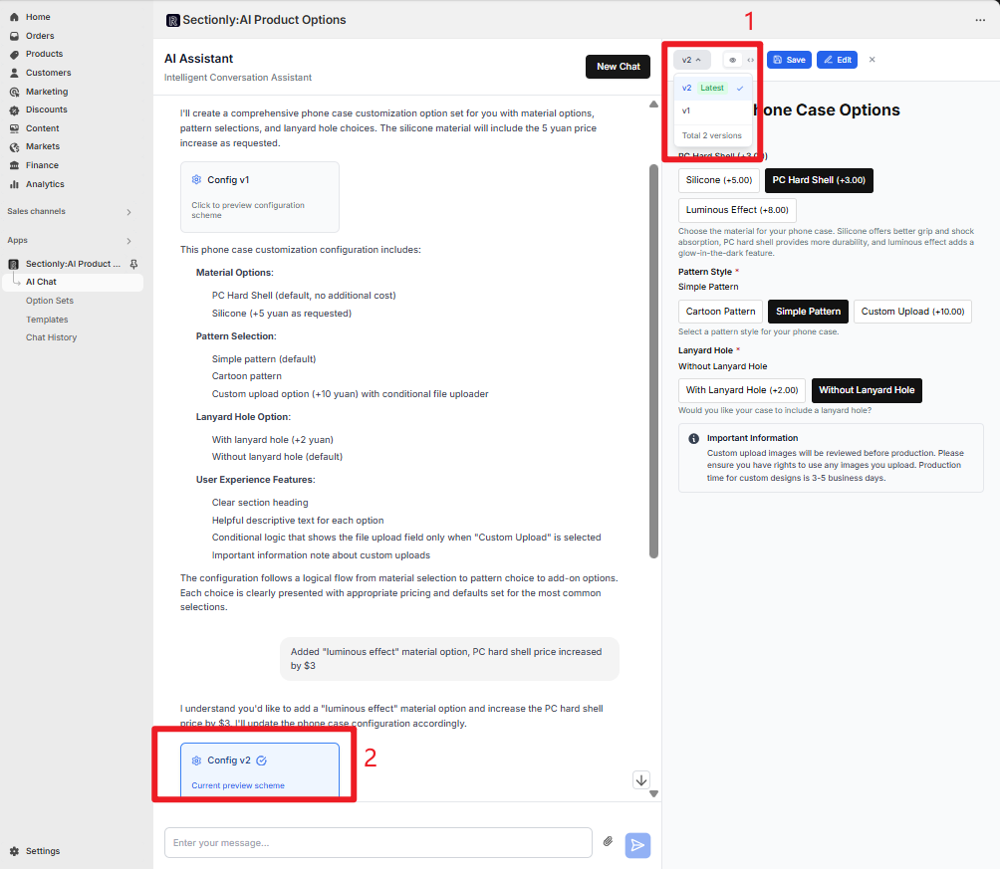

</Tab>
</Tabs>

### Pausing Conversation or Adding Requirements

<AccordionGroup>
<Accordion title="Pause Execution">

During AI generation or configuration optimization, if you discover errors in the content or need to add new requirements:

1. Click the pause button on the right side of the input field
2. AI will immediately stop the current execution process

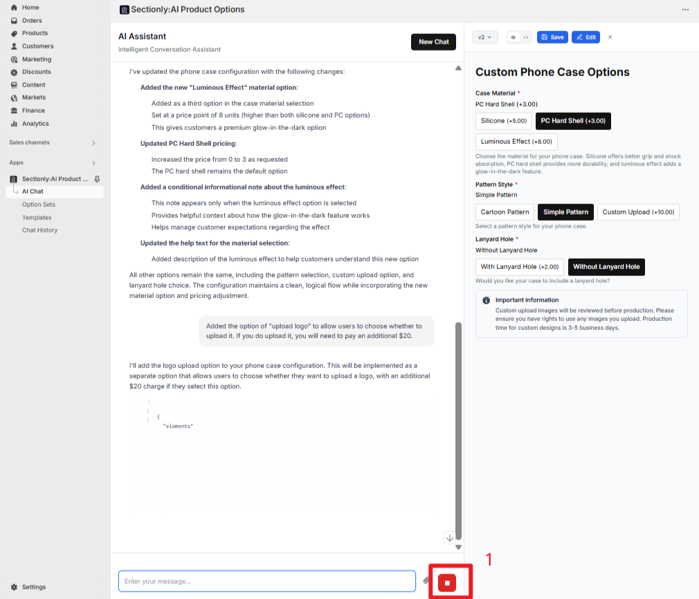

</Accordion>

<Accordion title="Continue Execution">

After pausing, you can add new instructions in the input field:

**Example:**
```
Correct the glow material price description and add logo upload option
```

After pressing Enter, AI will continue executing configuration generation/optimization based on the paused conversation context combined with new requirements, without needing to restart the conversation.

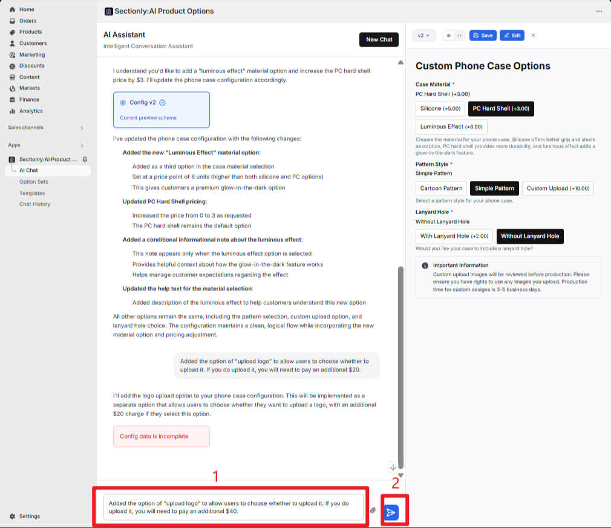

</Accordion>
</AccordionGroup>

## Configuration Saving

### Save Operation

<Steps>
<Step title={"After confirming a version configuration, click the \"Save\" button next to the configuration card in the chat area"}>
</Step>
<Step title={"The \"Save Configuration\" dialog will appear"}>
</Step>
<Step title={"Name the configuration (defaults to a timestamped name like `AI Generated Config - 8/18/2025, 4:03:37 PM`)"}>
</Step>
<Step title={"The configuration will automatically sync to the \"Option Sets\" list in the left navigation"}>
</Step>
</Steps>

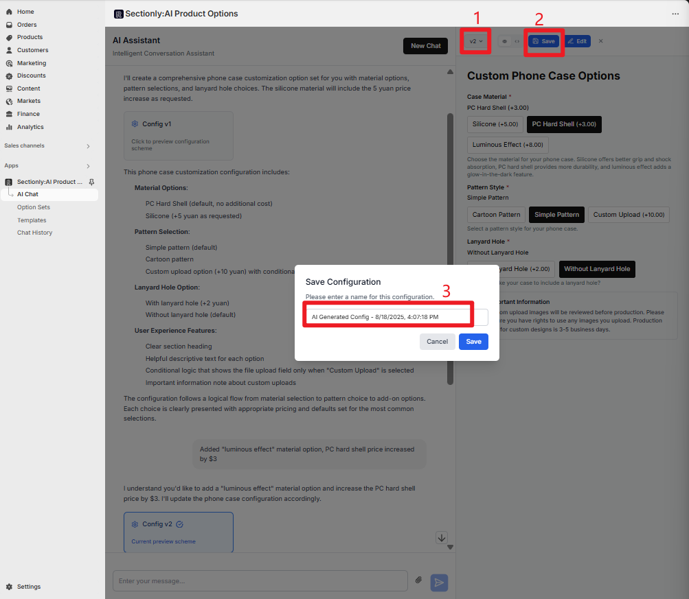

### Manual Configuration Editing

<Info>
Saved configurations support manual editing for more granular control.
</Info>

<Steps>
<Step title={"Click the \"Edit\" button to open the current version's configuration dialog"}>
</Step>
<Step title={"This interface supports manual editing and modification of the configuration"}>
</Step>
<Step title={"After completing manual edits:"}>
- Click the `Save` button in the top right to save modifications
- Click `Cancel` to discard changes and close the edit dialog
</Step>
<Step title={"The configuration will automatically sync to the \"Option Sets\" list in the left navigation"}>
</Step>
</Steps>

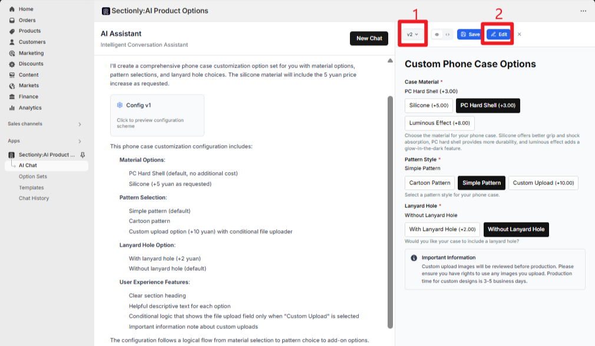

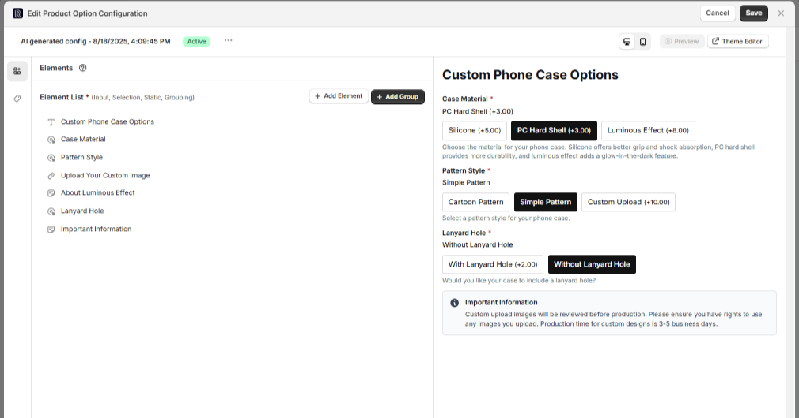

## Applying Option Sets to Product Configuration

### Access Option Sets List

<Steps>
<Step title={"Click \"Option Sets\" in the left navigation"}>
</Step>
<Step title={"Find the AI-generated and saved option set (e.g., AI Generated Config)"}>
</Step>
<Step title={"Click to enter the edit page"}>
</Step>
</Steps>

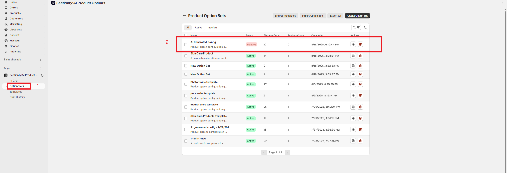

### Set Product Application Scope

<Tabs>
<Tab title="Manual Selection">

**Manual Product Selection**

1. Enable the "Manual Selection" toggle
2. Click "Click to select products"
3. Search and select target products (supports multiple selection)

</Tab>
<Tab title="Apply to All Products">

**Apply to All Products**

Enable the "Apply to All Products" toggle to automatically apply the option set to all products (suitable for universal customizations like "gift box packaging for all products")

</Tab>
</Tabs>

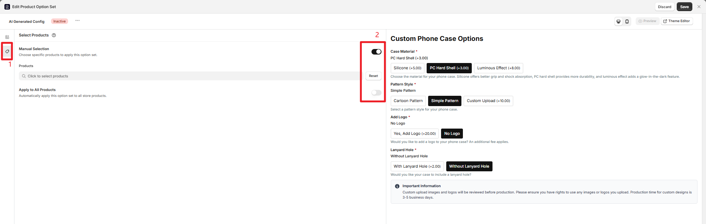

### Basic Information Configuration

<Steps>
<Step title={"Click the \"⋯\" button next to \"New Option Set\""}>
</Step>
<Step title={"In the popup dialog, modify the option set name (e.g., \"Summer T-shirt Customization\")"}>
</Step>
<Step title={"Select status:"}>
- "Active" (effective, can be applied to products)
- "Inactive" (inactive, temporarily not applied)
</Step>
</Steps>

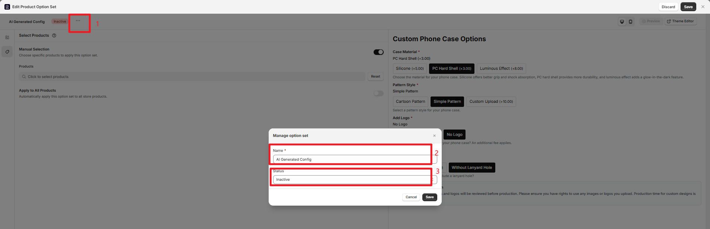

### Final Save

<Steps>
<Step title={"Click the \"Save\" button to sync the template configuration to the left Option Sets list"}>
</Step>
<Step title={"Click the \"Discard\" button to abandon reuse"}>
</Step>
</Steps>

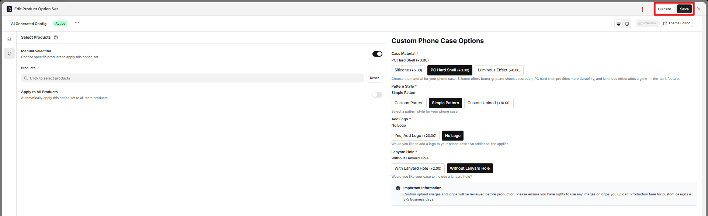

## Important Notes

<Warning>
**Important Reminders**
- AI-generated configurations support multiple iterative optimizations
- Version management functionality facilitates comparing different configuration effects
- Saved configurations can be further manually edited
- Recommend thoroughly testing preview effects before saving
</Warning>

<Info>
**Best Practices**
- Providing detailed requirement descriptions improves AI generation quality
- Make good use of multimedia assistance (images, documents, links)
- Utilize version comparison functionality to select optimal configurations
- Use the pause function wisely to avoid erroneous generation
</Info>
