This guide provides detailed instructions on how to manually create product option sets in Sectionly:AI Product Options, covering core features including element addition, group management, and application settings.

## Accessing the Creation Page

### Navigation Path

<Steps>
<Step title={"Enter the App admin dashboard"}>
</Step>
<Step title={"Select \"Sectionly:AI Product Options\""}>
</Step>
<Step title={"Click \"Option Sets\""}>
</Step>
<Step title={"Click \"Create Option Sets\""}>
</Step>
</Steps>

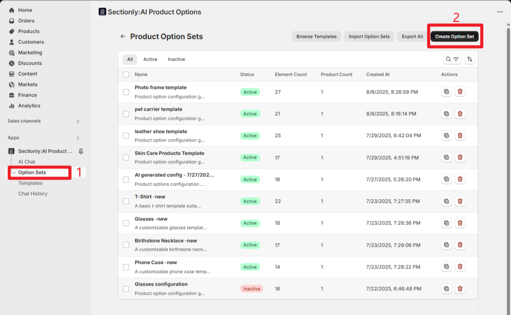

## Core Workflow

### Adding Elements

<Info>
Click the "+ Add Element" button and the system will display an element type selection menu with 3 main categories of different element types to choose from.
</Info>

1. **Select Element Type**
   - Choose the desired element type from the popup menu
   - For example: Click "Text Input" and the element will be immediately added to the list
   - The preview area on the right will display the added element effects in real-time

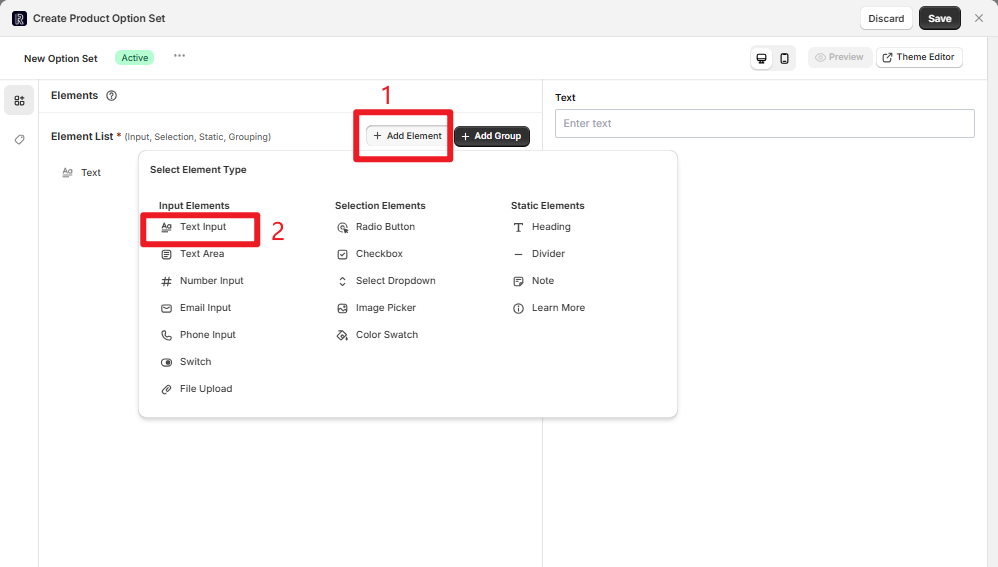

2. **Configure Element Properties**
   - Configure each element's settings according to your specific needs
   - For detailed configuration options, please refer to the related documentation

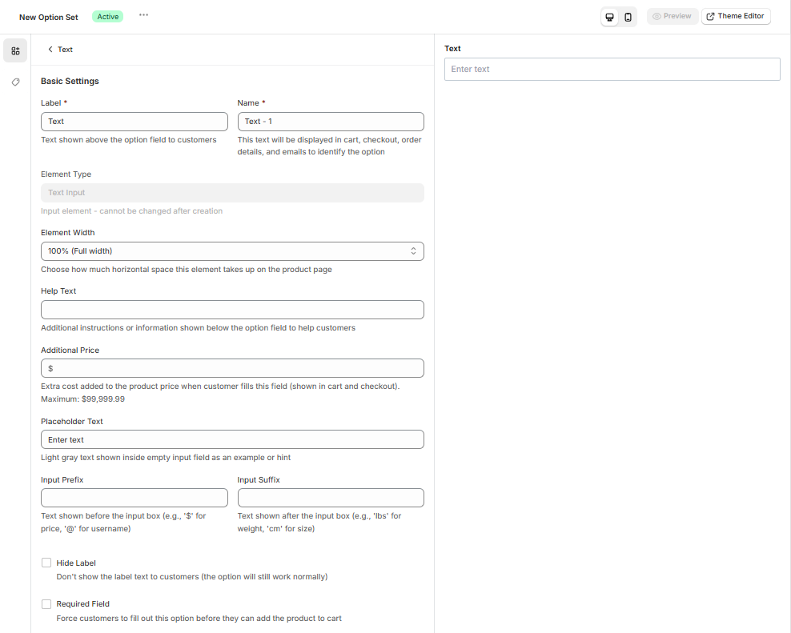

### Group Management

The grouping feature helps you better organize related elements and optimize frontend display logic.

<Steps>
<Step title={"Click \"Add Group\" to add a group element"}>
</Step>
<Step title={"In \"Group Members\", check the elements you want to include in the group"}>
</Step>
<Step title={"Elements will be displayed in the group according to their order in the main list"}>
</Step>
</Steps>

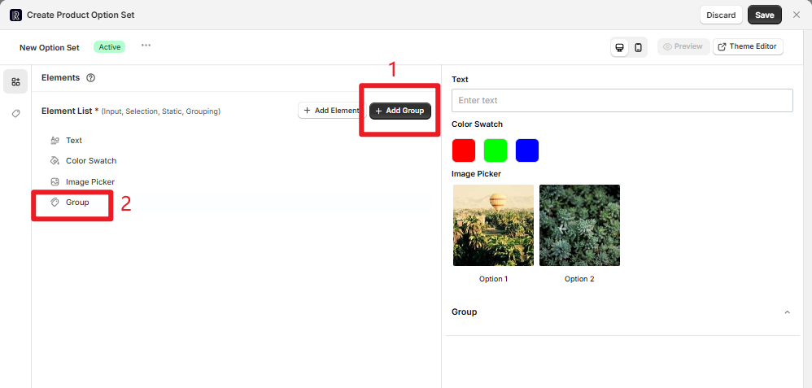

**Group Example:**
When creating an "Appearance Customization" group, you can check the already added "Color Swatch" and "Image Picker" elements. In the frontend preview, these two elements will be displayed under this group.

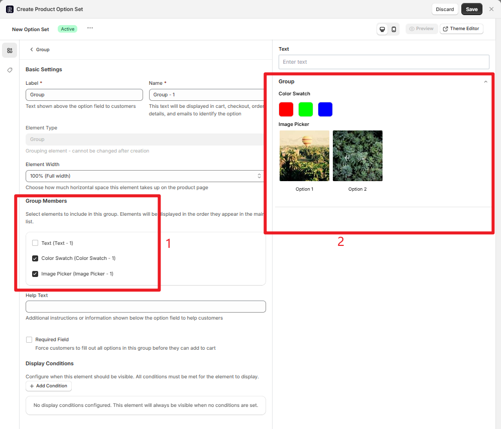

## Option Set Application and Settings

### Product Application Scope

<Tabs>
<Tab title="Manual Selection">

**Manual Product Selection**

1. Enable the "Manual Selection" toggle
2. Click "Click to select products" to search and select target products
3. Each product has a "Remove" button on the right to individually remove unwanted products
4. Click the "Reset" button to clear all selected products at once and replan the application scope

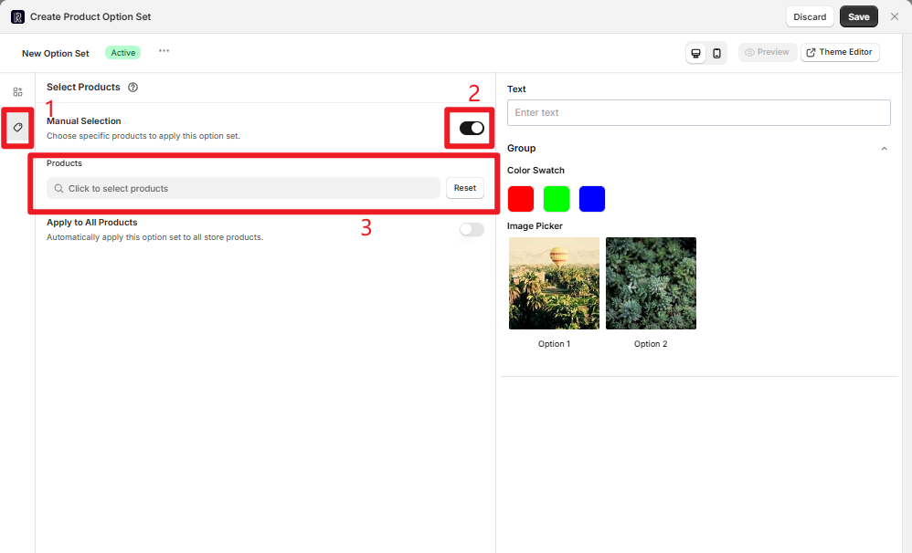

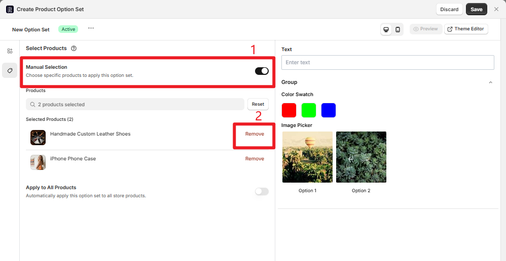

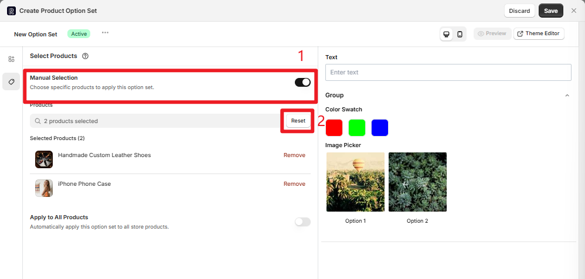

</Tab>
<Tab title="Apply to All Products">

**Apply to All Products**

Enable the "Apply to All Products" toggle to apply the option set to all products with one click, suitable for universal customization needs.

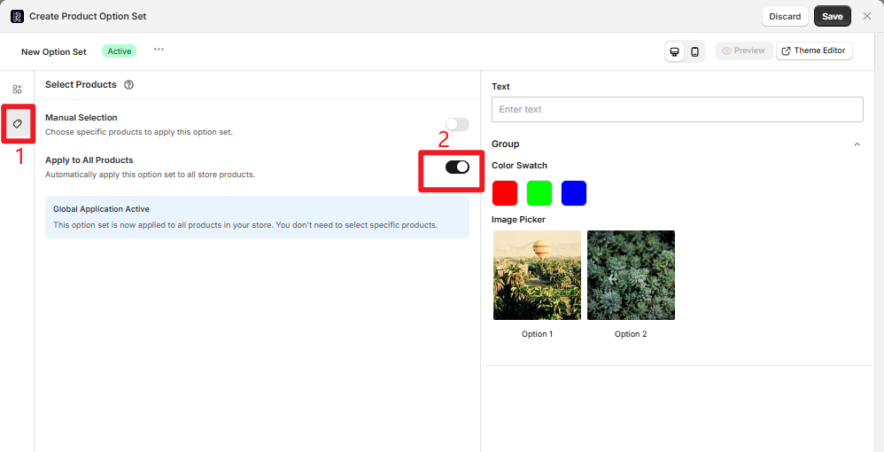

</Tab>
</Tabs>

### Basic Information Configuration

<Steps>
<Step title={"Click the \"⋯\" button next to \"New Option Set\""}>
</Step>
<Step title={"Modify the option set name in the popup window (e.g., \"Summer T-shirt Customization\")"}>
</Step>
<Step title={"Select status:"}>
- "Active": Enabled, can be applied to products
- "Inactive": Disabled, temporarily not applied
</Step>
</Steps>

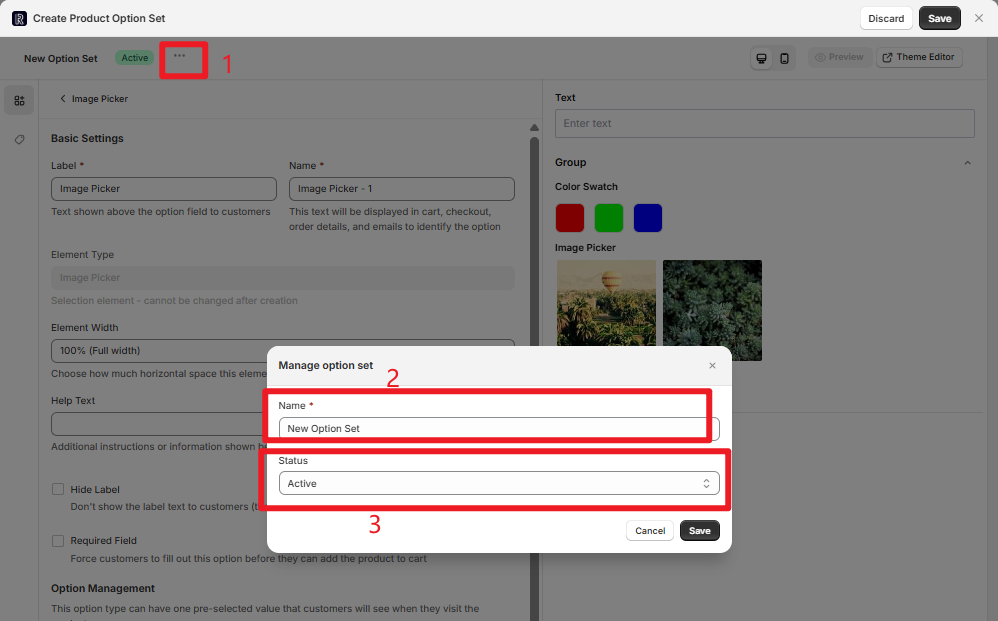

## Top Action Buttons

<AccordionGroup>
<Accordion title="Discard">
Abandon current configuration, close the popup without saving any changes.

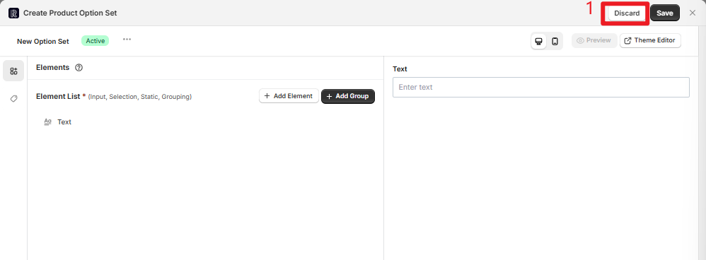
</Accordion>

<Accordion title="Save">
Save current configuration without closing the configuration popup, allowing continued adjustments.

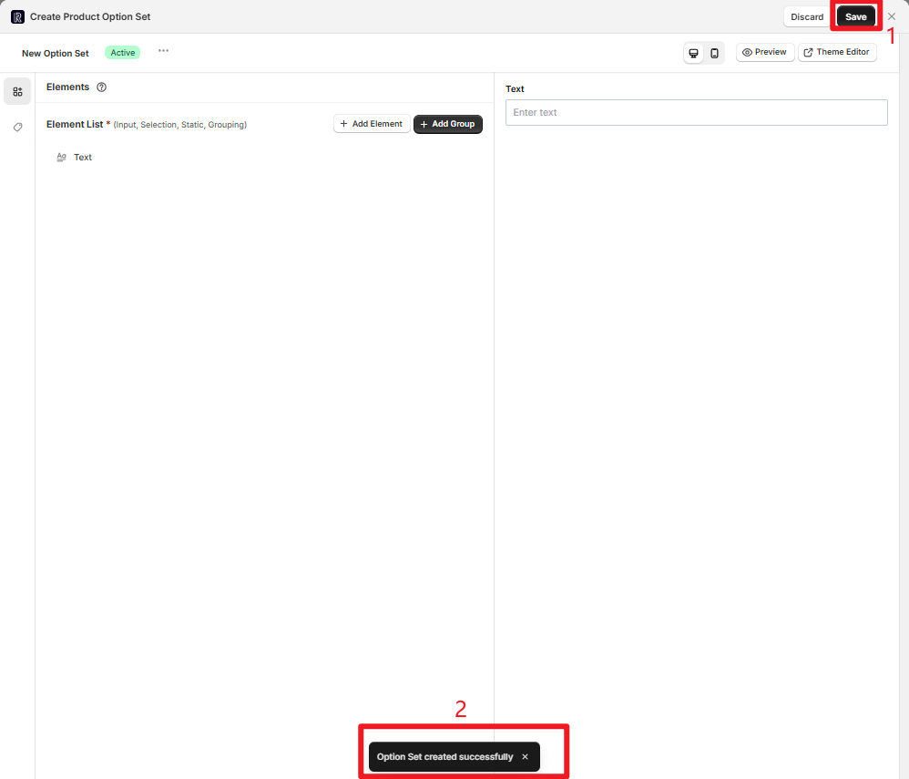
</Accordion>

<Accordion title="Preview Mode">
**Desktop Preview:**
Click the PC icon and the preview area on the right displays the desktop layout effect.

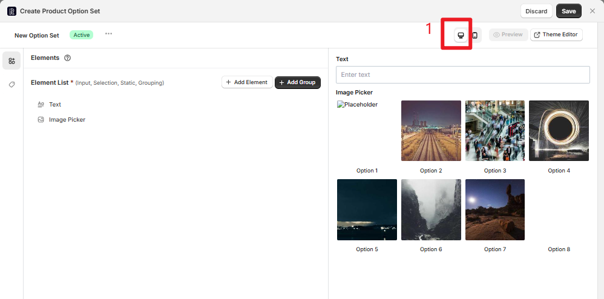

**Mobile Preview:**
Click the M icon and the preview area simulates mobile device interface layout.

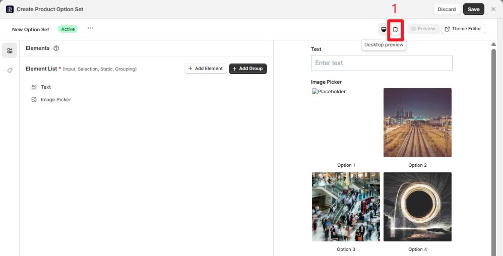
</Accordion>

<Accordion title="Theme Editor">
If you haven't configured App Block embedding and other display settings in the theme editor, or need to fine-tune how the option set displays in your store theme (such as position and style adaptation), click the "Theme Editor" button to quickly jump to the Shopify online theme editor.

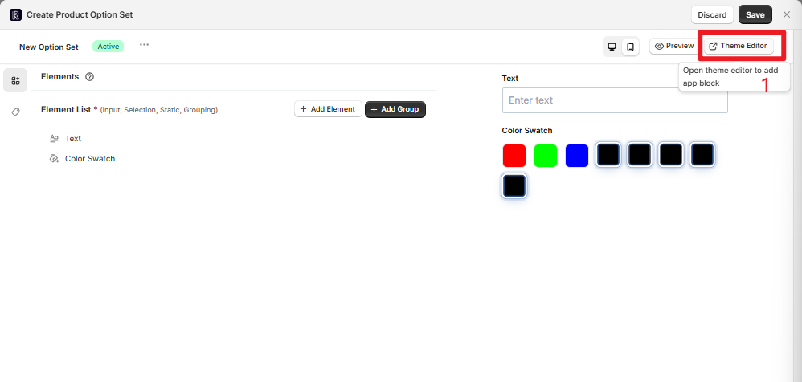
</Accordion>

<Accordion title="Preview (Validation)">
Click the "Preview" button to open a dedicated popup that only displays products where the current configuration is actually applied. Click "Preview" next to a product to jump to the frontend detail page and validate the configuration effects.

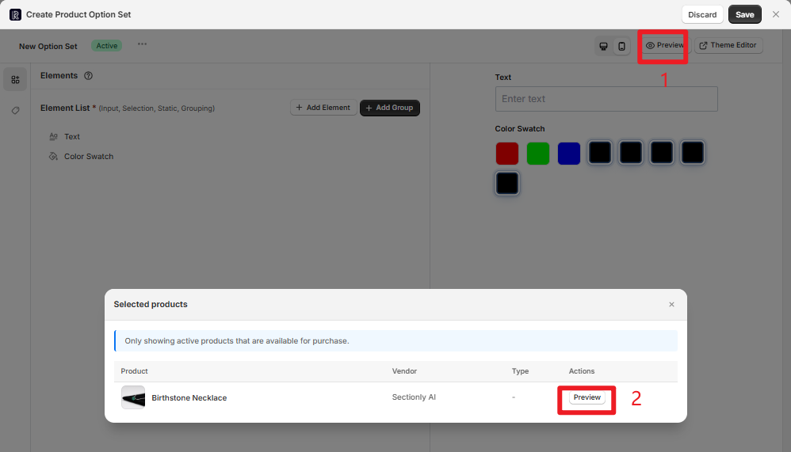
</Accordion>
</AccordionGroup>

## Important Notes

<Warning>
**Important Reminders**
- After creating an option set, the status defaults to "Active"
- You can manage option sets in the "Option Sets List" (such as modifying status, copying, deleting, etc.)
- When multiple active option sets have overlapping product applications, the system follows priority rules of "precise matching first" and "latest update takes precedence"
</Warning>
