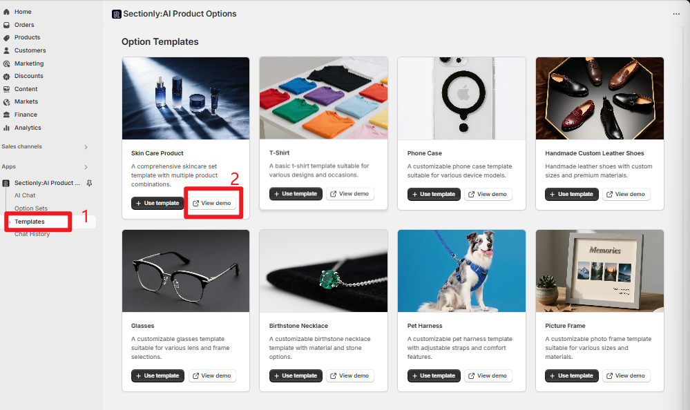
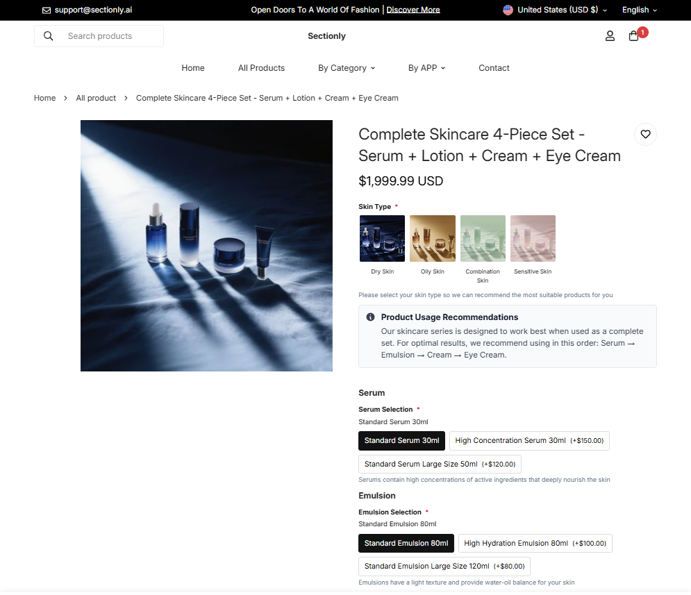
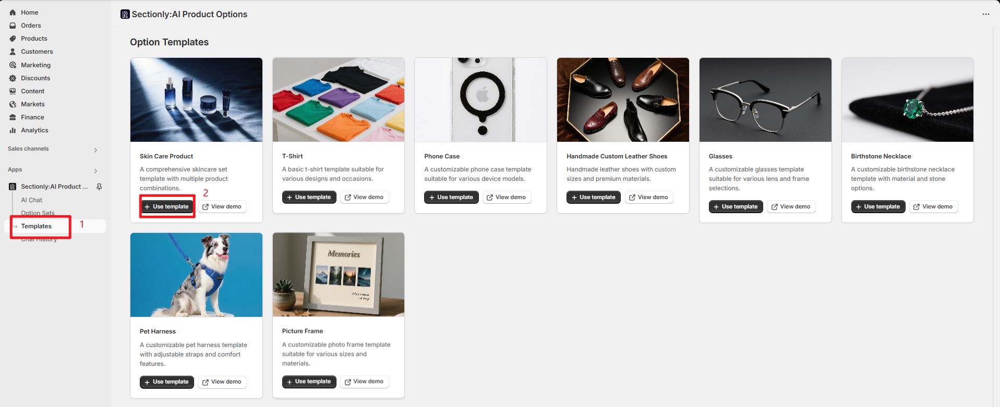
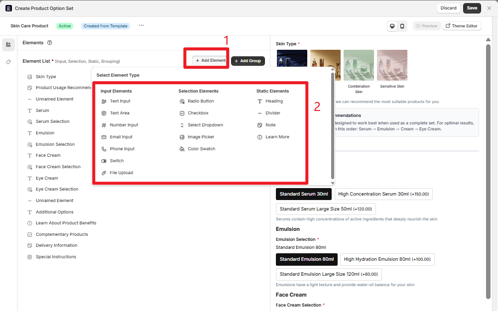
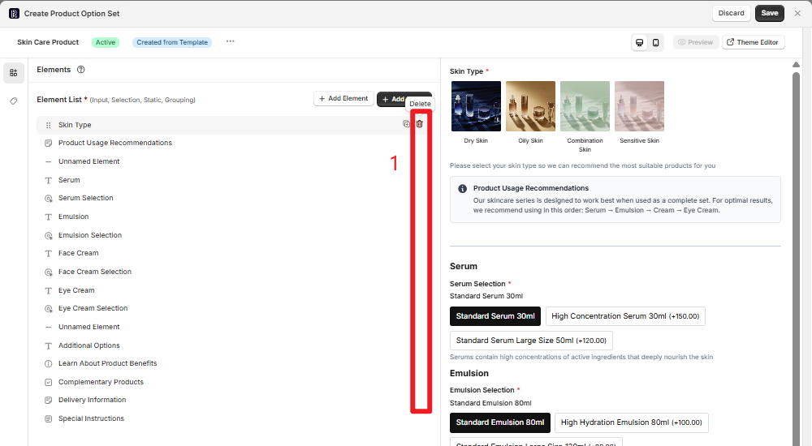
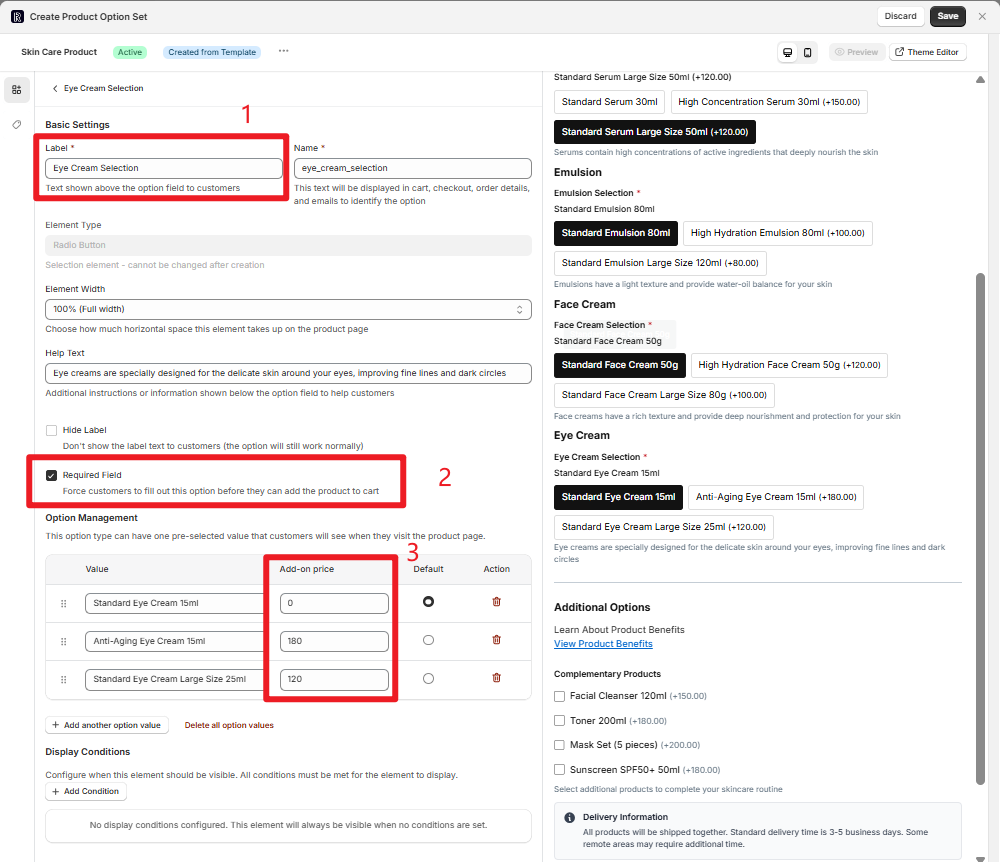
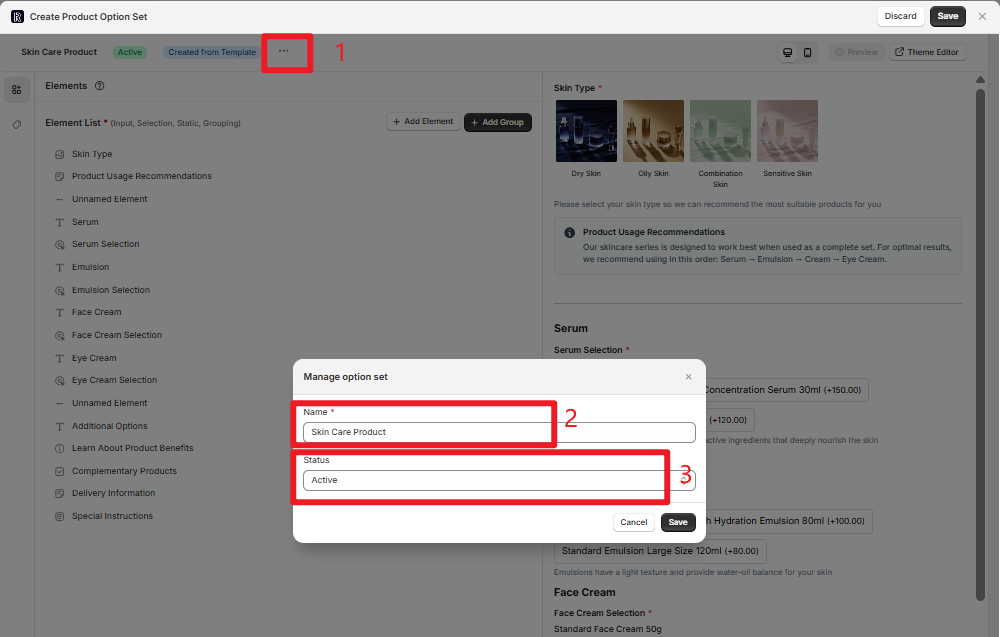
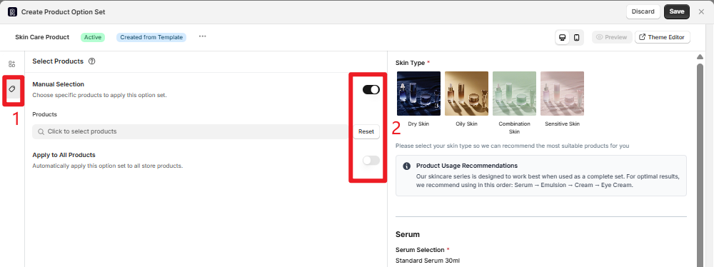
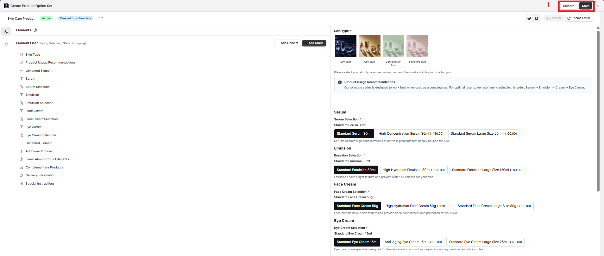

## Creating Product Options with Templates

Quickly create product option sets using preset templates without starting from scratch. Templates provide standardized configurations for common industries that can be used directly or as a foundation for personalized customization.

## Accessing the Template Page

<Steps>

<Step title={"Navigate to Template Center"}>

Follow this path to access the template page:

**App → Sectionly:AI Product Options → Templates**
</Step>

</Steps>

## Core Workflow

### Preview Template Effects

Before selecting a template, we recommend previewing the actual effects to understand the complete customization experience users will have on the frontend.

<Info>
**Preview Feature**

Click the **"View demo"** button to jump to the template frontend demo page, simulating the complete customization flow when users place orders.
</Info>

Through the preview page, you can experience:
- Selecting T-shirt colors, sizes, and other basic options
- Interactive flow for personalized customization options
- Price calculation and display effects
- Overall user experience flow

### Reusing Template Configuration

After confirming the template meets your needs, you can directly reuse the template configuration and make personalized adjustments.

<Steps>

<Step title={"Enable Template"}>

Click the **"Use template"** button, and the system will automatically redirect to the template's configuration page.

</Step>

<Step title={"Element Management"}>

On the configuration page, you can make deep adjustments to the template:

**Adding New Elements:**
- Click the **"+ Add Element"** button to add new customization items
- Supports multiple element types: text input, dropdown selection, color picker, etc.

**Removing Redundant Elements:**
- For unnecessary options, you can delete them directly
- Maintain simplicity in option sets to improve user experience

</Step>

<Step title={"Modify Configuration Items"}>

Each element can be configured in detail:

<Tabs>

<Tab title="Basic Settings">
- **Title Content**: Modify the display name of options
- **Required Field**: Set whether it's a mandatory option
- **Help Text**: Add option descriptions
</Tab>

<Tab title="Pricing Settings">
- **Additional Price**: Set surcharges for specific options
</Tab>

<Tab title="Display Conditions">
- **Conditional Logic**: Show/hide based on other option selections
- **Dependencies**: Set relationships between options
</Tab>

</Tabs>

</Step>

</Steps>

## Basic Information Configuration

### Option Set Settings

Configure the basic information and status of the option set:

<Tabs>

<Tab title="Basic Information">
- **Option Set Name**: Set a descriptive name for the option set
- **Description**: Add usage description for the option set
- **Tag Categories**: For easier management and searching later
</Tab>

<Tab title="Status Management">
- **Active**: Option set is effective and displayed on the frontend
- **Inactive**: Option set is paused and not displayed on the frontend
</Tab>

</Tabs>

## Option Set Application and Settings

Choose the application scope of the option set, determining which products will display this option set.

<Tabs>

<Tab title="Manual Selection">
### Manual Selection

Suitable for customization needs of specific products:

1. Enable the **"Manual Selection"** toggle
2. Click **"Click to select products"**
3. Search and select target products (supports multiple selection)
4. Confirm the selected product list

<Info>
**Use Case**

Suitable for scenarios requiring precise control, such as high-end custom products, limited edition items, etc.
</Info>
</Tab>

<Tab title="Apply to All">
### Apply to All Products

Suitable for universal customization options:

1. Enable the **"Apply to All Products"** toggle
2. Option set automatically applies to all products in the store
3. Newly added products will also automatically include this option set

<Warning>
**Use Case**

Suitable for universal services like "gift wrapping," "expedited shipping," etc., that apply to all products.
</Warning>
</Tab>

</Tabs>

## Save and Management

### Save Option Set

After completing configuration, you need to save the option set to make it effective:

<Steps>

<Step title={"Save Configuration"}>

Click the **"Save"** button to save the current configuration:
- Template configuration will sync to the left **Option Sets** list
- Option set status becomes manageable
- Effects can be seen on product pages
</Step>

<Step title={"Discard Changes"}>

If you're not satisfied with the current configuration, click the **"Discard"** button:
- Discard all current changes
- Return to the template selection page
- No configuration information will be saved
</Step>

</Steps>

<Tip>
**Best Practice**

We recommend using the preview feature to test the option set's effects before saving to ensure the user experience meets expectations.
</Tip>

## Next Steps

After completing template configuration, you can:

1. **Test Effects**: View the actual display effects of the option set on product pages
2. **Continue Optimization**: Adjust option configuration based on actual usage
3. **Copy Template**: Create more variants based on current configuration
4. **Manage Status**: Enable or disable option sets at any time

<Info>
**Tip**

Templates are just the starting point. You can customize deeply based on specific business needs to create unique product customization experiences.
</Info>
