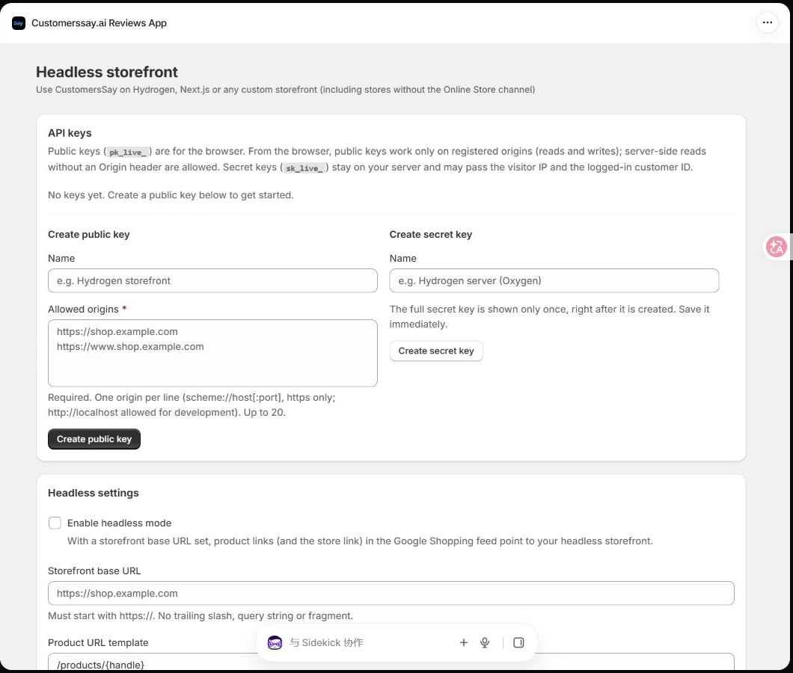
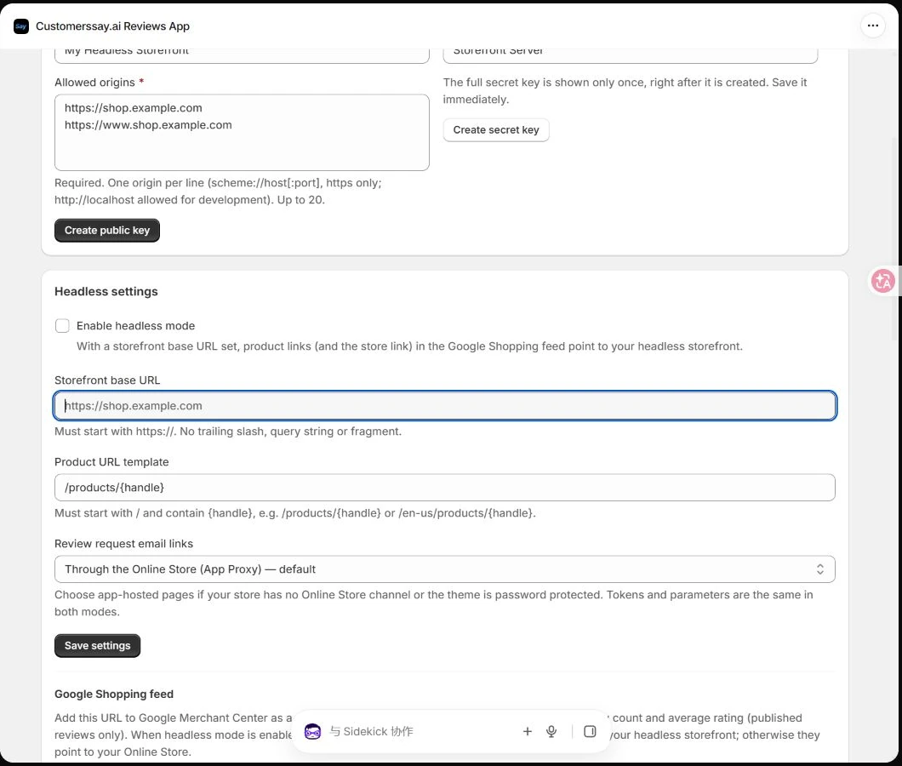

Use CustomersSay Reviews with Hydrogen, Next.js, or another custom Shopify storefront. Start by creating keys in the app, then choose a ready-made widget or build your own interface and styles.

<Note>
Submissions belong to the Shopify store that owns the key. Merchants manage them in **Shopify admin → Customerssay.ai Reviews App → Manage Reviews**. Reviews that require moderation become public after approval, according to the store's review settings.
</Note>

## Before you start

- Install the production Customerssay.ai Reviews App on the Shopify store.
- Prepare your storefront domain and a real product ID from that store.
- Decide whether requests will come from the browser, your server, or both.

## Create API keys

Open **Shopify admin → Apps → Customerssay.ai Reviews App → Headless**.

<Frame caption="The public and secret key creation sections in the Headless page">
  
</Frame>

### Create a public browser key

1. Under **Create public key**, enter a recognizable **Name**, such as `Production storefront`.
2. Add your real storefront origins to **Allowed origins**, one per line. For example, `https://shop.example.com` and `https://www.shop.example.com`.
3. Click **Create public key** and copy the complete key starting with `pk_live_`. You can copy an existing public key from the key list later.
4. Use this key in your browser integration. Register development and production origins separately.

An origin consists of the scheme, hostname, and optional port. It has no path or wildcard. `https://shop.example.com` and `https://www.shop.example.com` are different origins, as are `http://localhost:3000` and `http://localhost:5173`. Use HTTPS in production. Local HTTP origins such as `http://localhost:3000` are supported. Each public key allows up to 20 origins.

### Create a secret server key

1. Under **Create secret key**, enter a name such as `Storefront server`.
2. Click **Create secret key** and immediately save the complete key starting with `sk_live_`. Its full value is shown only once.
3. Store it in your server environment or deployment platform's secret settings, then redeploy the server.

<Warning>
Keep secret keys out of browser JavaScript, HTML, public environment variables, screenshots, and source control. Browser requests carrying a secret key are rejected. These are CustomersSay storefront API keys; your frontend does not need a Shopify Admin access token.
</Warning>

## Configure your storefront links

In **Headless settings**, enable **Enable headless mode** when Google Shopping feed product links should point to your custom storefront. Enter a **Storefront base URL**, such as `https://shop.example.com`, and a **Product URL template**, such as `/products/{handle}`, then click **Save settings**.

<Frame caption="Storefront URL, product path, and review request email link settings">
  
</Frame>

The base URL must use HTTPS and must not include a query string or fragment. Remove its trailing slash. The product path must start with `/` and include `{handle}`; `/en-us/products/{handle}` is another valid example.

If your store has no Online Store channel, or its theme storefront is password protected, select **App-hosted pages** for **Review request email links**, then save. Review request and unsubscribe links will use app-hosted pages. Theme stores can keep the default App Proxy mode.

The headless mode setting controls link destinations. API requests are authenticated with their keys.

## Choose an integration

| Method | What you build | Best for |
| --- | --- | --- |
| Embedded JavaScript | Add a script and a product container | Quickly adding the complete review widget |
| API with your own styles | Build your HTML, React, Vue, and CSS | Complete control over design and interaction |
| Server rendering | Fetch with a secret key on your server | Initial HTML, SEO, and trusted customer identity |

The production API base URL is:

```text
https://app-next.customerssay.ai/api/storefront/v1
```

## Add the embedded JavaScript widget

Place this on the product page. Replace the public key, Shopify store domain, and product ID with values from your store. Numeric product IDs and Shopify Product GIDs are supported. Set the configuration before loading `embed.js`.

```html
<link rel="stylesheet"
  href="https://app-next.customerssay.ai/api/storefront/v1/embed.css">
<script>
  window.CustomersSayConfig = {
    apiBase: 'https://app-next.customerssay.ai/api/storefront/v1',
    publicKey: 'pk_live_REPLACE_WITH_YOUR_PUBLIC_KEY',
    shop: 'YOUR_STORE.myshopify.com'
  };
</script>
<script src="https://app-next.customerssay.ai/api/storefront/v1/embed.js"
  defer></script>
<div data-customerssay-reviews
  data-product-id="YOUR_PRODUCT_ID"></div>
```

1. Deploy the page to a registered origin. Opening a local `file://` HTML file is not a valid storefront origin.
2. Open a real product page and check the reviews, rating, and write-review entry point. Products without published reviews show an empty state.
3. Submit a clearly marked test review and check **Manage Reviews**. Publish it if the store requires approval.

When a single-page app changes products, call `window.CustomersSay.unmount(element)` before mounting the new product with `window.CustomersSay.mount(element, { productId })`.

For a site with a Content Security Policy, allow the app domain for scripts, styles, and API connections, and allow the media storage domain for images and videos. Add your framework's actual nonce to the configuration script when required. The widget needs style attribute permission, such as `style-src-attr 'unsafe-inline'`. Swiper assets are served by the app domain.

## Use the API with your own styles

Run browser requests from a registered origin. Put the following read and submit examples in the same frontend ES module or `<script type="module">` so top-level `await` and shared configuration work. Add `<ul id="review-list"></ul>` to your page first.

```javascript
const apiBase = 'https://app-next.customerssay.ai/api/storefront/v1';
const publicKey = 'pk_live_REPLACE_WITH_YOUR_PUBLIC_KEY';

async function loadReviews(productId, page = 1) {
  const url = new URL(`${apiBase}/reviews`);
  url.search = new URLSearchParams({
    product_id: productId, page: String(page), limit: '10',
  }).toString();
  const response = await fetch(url, {
    headers: {'X-CustomersSay-Key': publicKey},
    signal: AbortSignal.timeout(10000),
  });
  const data = await response.json();
  if (!response.ok || data.success === false) {
    const message = typeof data.error === 'string'
      ? data.error : data.error?.message;
    throw new Error(message || `HTTP ${response.status}`);
  }
  return data;
}

const data = await loadReviews('YOUR_PRODUCT_ID');
const list = document.querySelector('#review-list');
list.replaceChildren(...data.reviews.map(review => {
  const item = document.createElement('li');
  item.textContent = `${review.rating}/5 — ${review.content || ''}`;
  return item;
}));
```

Style `#review-list` and its list items with your own CSS. In React or Vue, keep the response in state and render review content as text. Do not insert untrusted review content as raw HTML.

Use `summary.total_reviews` and `summary.average_rating` for your rating summary, and `pagination.hasNextPage` and `pagination.totalPages` for pagination. Product review star filtering uses `rating_filter`, not `rating`.

### Submit a review

Product review submission uses **FormData**, not JSON. Let the browser set `Content-Type` and its multipart boundary. Required fields follow the store's form settings; ratings must be integers from 1 to 5.

```javascript
async function submitReview({productId, email, nickname, rating, content}) {
  const form = new FormData();
  form.set('productId', productId);
  form.set('email', email);
  form.set('nickname', nickname);
  form.set('rating', String(rating));
  form.set('content', content);

  const response = await fetch(`${apiBase}/reviews`, {
    method: 'POST',
    headers: {'X-CustomersSay-Key': publicKey},
    body: form,
  });
  const data = await response.json();
  if (!response.ok || data.success === false) {
    throw new Error(typeof data.error === 'string'
      ? data.error : data.error?.message || 'Review submission failed');
  }
  return data;
}
```

Connect this function to your form handler and show loading, success, and error states. Submission success does not necessarily mean immediate publication. Public-key submissions do not automatically receive a verified purchase badge.

This endpoint does not have the B2B inquiry API's `Idempotency-Key` contract. Do not silently repeat a timed-out review submission; ask the customer to check the result or retry explicitly.

### Upload images and video

1. Send a FormData request to `POST /media-upload?productId=YOUR_PRODUCT_ID`, with `file`, `type` (`image` or `video`), and the `X-CustomersSay-Key` header.
2. Read `file.url`, `file.type`, `file.thumbnailUrl`, and `file.tempId` from the response. Reuse the returned `tempId` for other files in the same review.
3. Add the upload results to `mediaUrls[]`, `mediaTypes[]`, and `mediaThumbnails[]` when submitting the review. Keep the arrays in matching order; use an empty string when an image has no thumbnail URL.

Validate file sizes before uploading: images up to **2 MB** each, video up to **20 MB**, at most **6 images and 1 video** per review, and **30 MB** of media in total. Do not retry an unchanged oversized request after a `413` response. The embedded widget handles the selection and upload flow for you.

## Render reviews on your server

Call the API from a Hydrogen server loader, a Next.js server route, or another backend. Read the secret key from server-only configuration. Do not return it in loader data or component props, or expose it through `PUBLIC_` or `NEXT_PUBLIC_` variables.

The following helper can live in a `.server.js` module:

```javascript
// Server only. Call this helper from your existing loader or server route.
export async function loadServerReviews({
  apiBase, secretKey, productId, visitorIp, userAgent,
}) {
  const url = new URL(`${apiBase}/reviews`);
  url.searchParams.set('product_id', productId);
  const headers = new Headers({Authorization: `Bearer ${secretKey}`});
  if (visitorIp) headers.set('X-CustomersSay-Client-IP', visitorIp);
  if (userAgent) headers.set('X-CustomersSay-Client-UA', userAgent);
  const response = await fetch(url, {
    headers, signal: AbortSignal.timeout(10000),
  });
  if (!response.ok) throw new Error(`Reviews API: ${response.status}`);
  return response.json();
}
```

Render the returned reviews, summary, and pagination in your initial HTML. For SEO, also fetch `/json-ld` and merge it with your product page's existing Product JSON-LD to avoid conflicting duplicate Product nodes.

For server-side submission, send FormData to `/reviews` using `Authorization: Bearer <secret key>`. Do not forward the browser's `Origin` header with a secret-key request. Validate your own relay route, fix the upstream API destination, and apply CSRF protection and rate limits.

Derive the real visitor IP from your platform or trusted proxy. Forward it in `X-CustomersSay-Client-IP` and forward the visitor's User-Agent in `X-CustomersSay-Client-UA` so visitor rate limits and reaction state are consistent.

For automatic verified purchase checks, first authenticate the logged-in customer on your server, then send `X-CustomersSay-Customer-Id`. Do not trust a customer ID supplied directly by browser form data. Public-key submissions are not automatically verified.

The optional `@customerssay/react` package provides components and server helpers. It is **not published to public npm**. Obtain the source or installation package from CustomersSay support before following the [React and server integration guide](https://app-next.customerssay.ai/headless/docs/react).

## API reference and troubleshooting

| Endpoint | Purpose |
| --- | --- |
| `GET /reviews` | Product reviews, pagination, and rating summary |
| `GET /rating-summary` | Aggregate rating |
| `GET /questions`, `POST /questions` | Product questions |
| `GET /store-reviews`, `POST /store-reviews` | Store reviews |
| `GET /widget-settings` | Widget and form configuration |
| `GET /json-ld` | Product review structured data |
| `POST /media-upload` | Product review media upload |

| Result | What to check |
| --- | --- |
| `401` | Complete key value, revocation, and app installation status |
| `403` or CORS failure | Exact origin and port, and whether a secret key was used in the browser |
| `400` | Product ID, rating, email, and required store form fields |
| `404` product not found | Product ownership in the key's store |
| `429` | Wait for `Retry-After` before retrying |
| Submitted but not visible | Moderation and publication status in Manage Reviews |
| Wrong product's reviews | Product ID and instance cleanup during SPA navigation |

Base limits apply per key and visitor IP: **120 reads/minute** and **20 writes/minute**, with additional endpoint-specific limits. Without a trusted forwarded visitor IP, secret-key SSR requests share your server's outbound IP quota.

Show a recoverable error for timeouts, `5xx`, or `429`. Do not turn a failed read into an apparent zero-review result. Error responses can contain either a string `error` or an object with `code` and `message`.

## Rotate keys and verify the release

1. Create the replacement key and register the production origin.
2. Update your frontend or server configuration, redeploy, and verify reads and submissions.
3. Use **Edit origins** to change an existing public key's allowlist. Use **Revoke** and confirm to disable an old key. Create a replacement if a secret key is lost.

Revocation takes effect immediately. Uninstalling the app also revokes its keys; reinstalling requires new keys and updated storefront configuration.

Before going live, check desktop and mobile layout, empty and paginated results, star filters, unpublished reviews, and one test submission with an image. Confirm that no `sk_live_` key appears in page source or browser requests, and provide clear handling for origin failures, rate limits, and service outages.

See the [complete Storefront API contract](https://app-next.customerssay.ai/headless/docs) for the remaining endpoints and request details.

Updated November 11, 2026. Screenshots use a demonstration store. Replace all example domains, keys, and product IDs with your own values.
