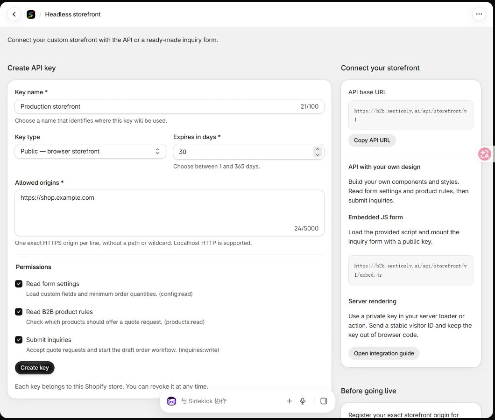
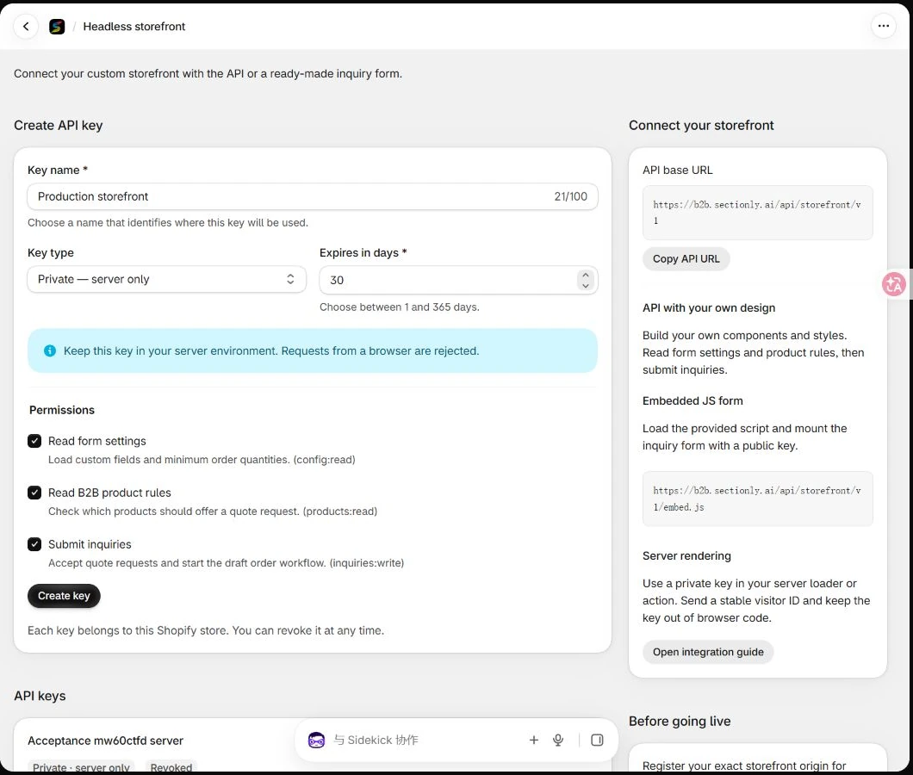

<Note>
询价会进入 Shopify 后台的 Sectionly B2B 应用 → Inquiries。草稿订单随后异步创建，并显示在 Shopify 订单 → 草稿订单；创建失败时，询价仍保留，商家可在详情中查看错误并重试。
</Note>

本指南面向使用自建前端的 Shopify 商家和开发人员。从创建店面 API 密钥开始，完成商品 B2B 规则读取、询价表单接入和后台验收。你可以使用自己的界面和样式，也可以嵌入现成的 JS 询价组件。

## 一 开始前准备

- Shopify 店铺已安装正式版 Sectionly B2B Wholesale，商家能够正常打开应用。
- 在 Quote Settings 配置 B2B 商品或模板规则、最低起订量 MOQ，以及必填表单字段。
- 准备自建店面正式域名和真实商品及变体 ID；变体必须属于该店铺的对应商品。

Headless 店面应根据 API 返回的规则，自行控制价格展示和加入购物车入口。现成 JS 组件提供询价流程，不会自动接管你自己写的商品页、价格授权或结账权限。需要限制购买时，应在店面的服务端与结账流程中执行相应校验。

## 二 从后台创建公钥

进入 Shopify 后台 → 应用 → Sectionly B2B Wholesale → **Headless**。在 Create API key 表单创建店面密钥。

<Frame caption="图 1 B2B Headless 公钥创建表单">
  
</Frame>

1. Key name：输入用途名称，例如 Headless Browser Production。
2. Key type：选择 **Public — browser storefront**。
3. Allowed origins：每行填写一个真实店面 Origin，例如 `https://shop.example.com`。需要 www 子域时再另起一行填写。
4. Expires in days：填写 1 到 365 天。建议测试时使用 1 天；正式密钥按团队轮换周期设置，并记录到期时间。
5. Permissions：Read form settings 对应 config:read，Read B2B product rules 对应 products:read，Submit inquiries 对应 inquiries:write。完整询价组件需要三项权限；只读展示无需勾选 Submit inquiries。
6. 点击 **Create key**，立即复制完整的 **sb2b_pk_** 公钥。密钥完整值只显示一次，之后列表只显示前缀。

Origin 必须精确匹配协议、主机和端口，不能带路径或通配符。`https://shop.example.com` 和 `https://www.shop.example.com` 是两个 Origin。本地可使用 `http://localhost:端口` 或 `http://127.0.0.1:端口`，正式环境使用 HTTPS。

## 三 创建服务端私钥

如果使用服务端 SSR 或后端代提交，再新建一把密钥，将 Key type 改为 **Private — server only**。填写用途名称、有效期和所需权限；私钥不需要浏览器允许域名。

<Frame caption="图 2 将类型改为 Private 后创建服务端密钥">
  
</Frame>

点击 Create key 后立即复制 **sb2b_sk_** 私钥，保存到服务端 Secret 或环境变量。不要放在浏览器、HTML、公开构建变量或截图中；遗失后创建新密钥并撤销旧密钥。本文截图仅展示创建表单，没有创建新的生产凭据。

## 四 选用一种接入方式

| 方式 | 适合场景 | 密钥 |
| --- | --- | --- |
| 现成 JS 表单 | 快速加入询价表单和 SKU 选择 | 公钥 |
| API 自定义界面 | 自建 React、Vue、HTML 和完全自定义样式 | 浏览器使用公钥 |
| 服务端和 SSR | 首屏渲染或后端统一代提交 | 服务端私钥 |

API 基础地址为 `https://b2b.sectionly.ai/api/storefront/v1`。B2B 密钥与 Reviews 密钥独立，前缀和请求头不同，不能混用。

## 五 嵌入现成 JS 询价表单

把以下内容放到商品页。替换公钥、店铺域名，以及商品和变体数据；它们应从你的店面数据源读取，而不是在所有商品页复用同一个 ID。

```html
<div id="b2b-quote"></div>
<script src="https://b2b.sectionly.ai/api/storefront/v1/embed.js"></script>
<script>
  SectionlyB2B.mount({
    target: '#b2b-quote',
    apiBase: 'https://b2b.sectionly.ai/api/storefront/v1',
    publicKey: 'sb2b_pk_REPLACE_WITH_YOUR_PUBLIC_KEY',
    shopDomain: 'YOUR_STORE.myshopify.com',
    product: {
      id: 'YOUR_PRODUCT_ID',
      title: 'Your product title',
      handle: 'your-product-handle',
      variants: [{
        id: 'YOUR_VARIANT_ID', title: 'Blue / Large',
        sku: 'BLUE-L', available: true,
      }],
    },
  }).catch(error => {
    document.querySelector('#b2b-quote').textContent =
      'The quote form is temporarily unavailable. Please try again.';
    console.error(error);
  });
</script>
```

组件会加载表单字段和 MOQ，管理访客 ID 与本次提交的幂等标识。买家点击 Add SKUs 选择变体和数量，保存后填写联系信息及必填字段，再提交询价。每页支持一个表单，同店不同商品页之间可以共享询价清单；多个独立表单请自行通过 API 实现。

组件支持传纯数字 ID 或 Shopify GID。变体 available 应使用真实库存和可售状态，提交时后端仍会核对商品与变体归属。不要把浏览器传来的商品标题或 SKU 当作可信价格与商品依据。

### 调整样式

在 embed.css 加载后引入你自己的样式，并将覆盖规则限定在 .sectionly-b2b-form 容器。需要完全改造字段布局、按钮或交互时，选择 API 自定义界面最灵活。有严格 CSP 时，允许从应用域名加载脚本、样式和发起请求，配置脚本使用站点自己的 nonce。

## 六 API 配合自己的界面和样式

下面三个浏览器示例应按顺序放在同一个前端 ES 模块文件，或同一个 `<script type="module">` 中：生成访客标识、读取配置与商品规则、定义提交函数。把 submitInquiry 绑定到你自己的表单事件，并给页面添加加载、成功和错误状态。

### 为访客生成稳定标识

浏览器请求需要 X-Sectionly-Visitor。为当前访客生成随机的 16 到 80 字符标识，不要把所有用户写成同一个值。以下示例在当前标签页内保留标识；存储被禁用时回退为当前页面内的随机标识。

```javascript
let visitorId;
try {
  visitorId = sessionStorage.getItem('sectionly-visitor') || crypto.randomUUID();
  sessionStorage.setItem('sectionly-visitor', visitorId);
} catch {
  visitorId = crypto.randomUUID();
}
```

### 先读取表单配置和商品规则

```javascript
const apiBase = 'https://b2b.sectionly.ai/api/storefront/v1';
const publicKey = 'sb2b_pk_REPLACE_WITH_YOUR_PUBLIC_KEY';
const headers = {
  'X-Sectionly-Key': publicKey,
  'X-Sectionly-Visitor': visitorId,
};

async function readApi(path) {
  const response = await fetch(`${apiBase}${path}`, {
    headers, signal: AbortSignal.timeout(10000),
  });
  const data = await response.json();
  if (!response.ok) throw new Error(data.error || `HTTP ${response.status}`);
  return data;
}

const config = await readApi('/form-config');
const decisions = await readApi(
  '/b2b-products?handles=' + encodeURIComponent('your-product-handle')
);
```

根据 config 中的字段和最低数量生成自己的表单，再根据商品决策控制自建页面展示。商品 handle 每次最多 500 个唯一有效值，大目录应分批请求，不要把所有商品拼成一个无限增长的查询。

### 提交询价并支持安全重试

下面示例中的 18 仅为数量示例。实际必须达到你的商家 MOQ，customFields 必须包含 /form-config 返回的全部必填字段；例如商家还要求 Estimated Quantity 时，提交中也应包含它。

```javascript
// Create these once for one inquiry, outside the retry function.
const operationId = crypto.randomUUID();
const body = JSON.stringify({
  customerName: 'Test Buyer',
  customerEmail: 'buyer@example.com',
  productId: 'YOUR_PRODUCT_ID',
  productHandle: 'your-product-handle',
  lineItems: [{variantId: 'YOUR_VARIANT_ID', quantity: 18}],
  customFields: {'Company Name': 'Example Company'},
  note: 'Please quote delivery to our warehouse',
});

async function submitInquiry() {
  const response = await fetch(`${apiBase}/inquiry`, {
    method: 'POST', credentials: 'omit',
    headers: {
      ...headers,
      'Content-Type': 'application/json',
      'Idempotency-Key': operationId,
    },
    body,
  });
  const data = await response.json();
  if (!response.ok) throw new Error(data.error || `HTTP ${response.status}`);
  return data;
}
```

成功返回 HTTP 201 和 &#123;success:true,inquiryId&#125;。询价会先保存，后台再创建 Shopify 草稿订单并运行通知流程；不要把“询价保存成功”误当作草稿订单已经创建完成，应回后台核对 Draft Order 状态。

每条新询价使用新的 Idempotency-Key。网络断开、超时或 5xx 后重试同一询价时，必须保留相同 operationId 和完全不变的 body；成功重放返回原 inquiryId，且不会再次创建草稿订单。拿已经成功的键提交不同内容会返回 409。普通表单重载会开启新会话；需要跨刷新恢复提交时，自定义客户端应持久化操作 ID 和原始请求体直至获得结果。

整次提交的上限为 256 KiB、50 个商品、250 条变体明细；数量必须是正整数，累计数量不能超过 PostgreSQL 有符号整数范围。任何一项无效时整单被拒绝，不能默默丢弃无效商品。

## 七 服务端接入和 SSR

服务端可以先读取 /form-config 和 /b2b-products，直接渲染首屏表单，再通过你自己的后端提交。Hydrogen 和 Next.js 可以调用下面的通用辅助函数；密钥从各自服务端环境读取，不返回给浏览器。

```javascript
// Server only. Values come from your server configuration/session.
export async function relayInquiry({
  privateKey, visitorSessionId, operationId, validatedPayload,
}) {
  return fetch('https://b2b.sectionly.ai/api/storefront/v1/inquiry', {
    method: 'POST',
    headers: {
      'Content-Type': 'application/json',
      Authorization: `Bearer ${privateKey}`,
      'X-Sectionly-Visitor': visitorSessionId,
      'Idempotency-Key': operationId,
    },
    body: JSON.stringify(validatedPayload),
  });
}
```

visitorSessionId 应来自你的服务端会话，并在同一访客的多次请求中保持稳定。自己的转发路由要验证请求来源和表单字段，落实 CSRF 与限流，固定上游 API 地址；不要照搬浏览器传来的任意目标 URL。

私钥请求不能携带 Origin，也不要同时发送 Authorization 和 X-Sectionly-Key。将上游状态码、JSON 和 Retry-After 转发给页面；不要将所有失败转换为 200，也不要发生网络错误就自动生成新的操作 ID。

## 八 在后台验收一次完整询价

1. 打开真实商品页，检查 B2B 展示规则和表单必填项。先测试低于 MOQ 的数量，应有清楚提示。
2. 使用可收信的测试邮箱，填写带明显测试标记的姓名和公司，按实际 MOQ 选择数量并提交一次。
3. 到应用 Inquiries 查看同一条询价的商品、变体和数量，核对 Shopify 草稿订单是否创建；失败时查看错误后使用后台重试。
4. 确认买家收到或邮件服务已接受确认回执，核对商家通知配置。邮件服务接受不等于保证进入每个收件箱。
5. 首页 Needs attention 应只显示一次该询价。打开详情后返回首页，未报价时仍应显示 Awaiting quote。
6. 在桌面和手机检查长商品名、长公司名、SKU 弹窗、选择数量、清空及重复点击；测试完成后按团队要求保留样例或清理。

## 九 错误和限流排查

| 状态 | 原因与处理 |
| --- | --- |
| `400` | 缺少访客 ID 或幂等键，表单缺字段，数量无效，MOQ 或变体校验失败 |
| `401` | 密钥缺失、已到期、已撤销或店铺不可用 |
| `403` | 公钥域名不符、权限不足或浏览器误用私钥 |
| `409` | 成功的幂等键被用于不同内容，或近期重复询价 |
| `413` | 请求体超过 256 KiB |
| `415` | 提交的 `Content-Type` 不是 JSON |
| `429` | 触发访客或 IP 额度，按 `Retry-After` 等待 |
| `503` | 店铺授权、上游校验或基础服务暂时不可用；保留原请求标识后重试 |

当前额度：每位访客读 120 次每分钟、写 20 次每小时；公钥还按 IP 限制读 600 次每分钟、写 100 次每小时。私钥 SSR 不按一个共用服务端 IP 计整站总量，但仍必须正确区分访客。禁止使用一个固定访客 ID 代表所有人。

## 十 密钥轮换和正式上线

1. 在旧密钥到期前创建新密钥，保持相同的必要权限与真实允许域名。
2. 更新浏览器或服务端配置并部署，验证读取配置和询价提交成功。
3. 回 Headless 的 API keys 列表，对旧密钥点击 Revoke；在确认对话框中核对名称，再点击 Revoke key。确认状态变为 Revoked。
4. 应用卸载后密钥会被撤销，重装后需要重新创建并更新店面配置。

上线前检查：正确的正式域名、真实商品和变体、全部必填字段、MOQ、手机布局、网络失败安全重试、429 提示，以及浏览器和页面源码中没有 sb2b_sk_ 私钥。开发测试站和正式站建议分开使用密钥。

完整接口契约：[B2B Headless API 完整契约](https://b2b.sectionly.ai/headless/docs)

最后更新：2026 年 11 月 11 日。截图使用演示店铺；请替换示例域名、密钥、商品及变体 ID。
