本指南将详细介绍如何使用 AI 功能快速创建产品选项集，包括需求描述、对话交互、版本管理和配置保存等核心功能。

## 进入 AI 对话页面

### 导航路径

<Steps>
<Step title={"进入 App 管理后台"}>
</Step>
<Step title={"选择 \"Sectionly:AI Product Options\""}>
</Step>
<Step title={"点击 \"AI Chat\""}>
</Step>
</Steps>

## 核心操作流程

### 输入需求描述

在对话输入框中，用自然语言详细描述产品选项集需求。支持纯文字、图片、附件、链接等多种形式辅助说明。

<Tabs>
<Tab title="纯文字示例">

**示例描述：**
```
创建手机壳定制选项集，包含材质（硅胶、PC 硬壳）、图案（卡通、简约、自定义上传）、
挂绳孔（有无）选项，材质为硅胶时可加价 5 元
```

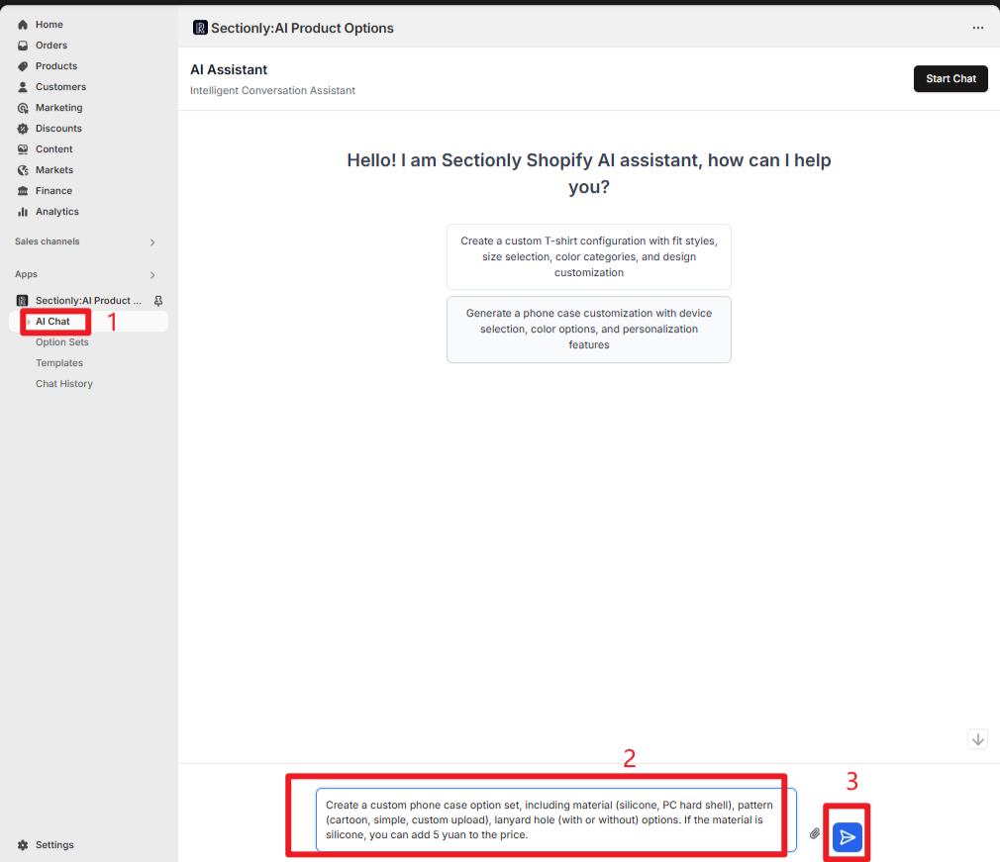

</Tab>
<Tab title="附件/图片/链接辅助">

**多媒体辅助说明：**

1. 点击输入框旁附件图标，上传参考图（如已有手机壳定制案例图）
2. 上传文档（含详细选项规则的 Excel）
3. 添加链接（产品定制页参考链接）
4. 图片和链接可以直接粘贴到输入框中

<Info>
多媒体辅助能让 AI 更精准理解需求，提高生成质量。
</Info>

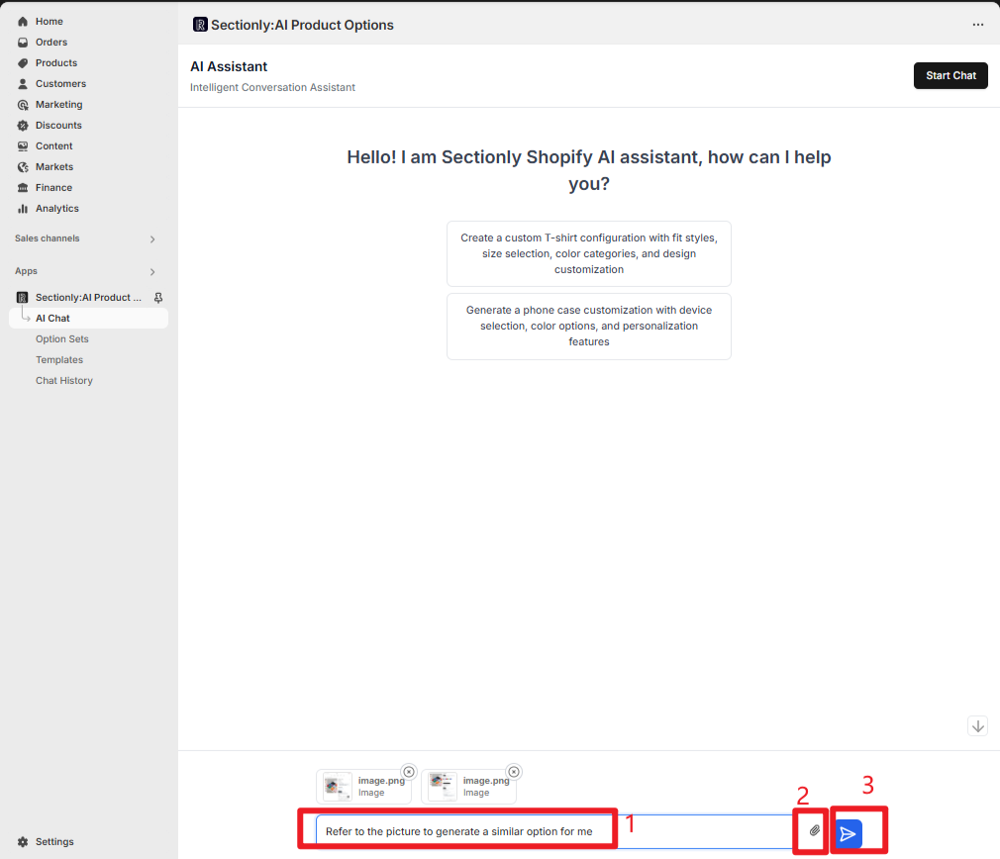

</Tab>
</Tabs>

### 对话交互与优化

#### 生成与预览

<Steps>
<Step title={"输入需求后按回车，AI 自动生成产品选项集配置"}>
</Step>
<Step title={"左侧显示对话内容，展示生成结果（含版本编号、大致配置内容）"}>
</Step>
<Step title={"右侧预览区呈现选项集前端效果（如选项布局、交互逻辑）"}>
</Step>
</Steps>

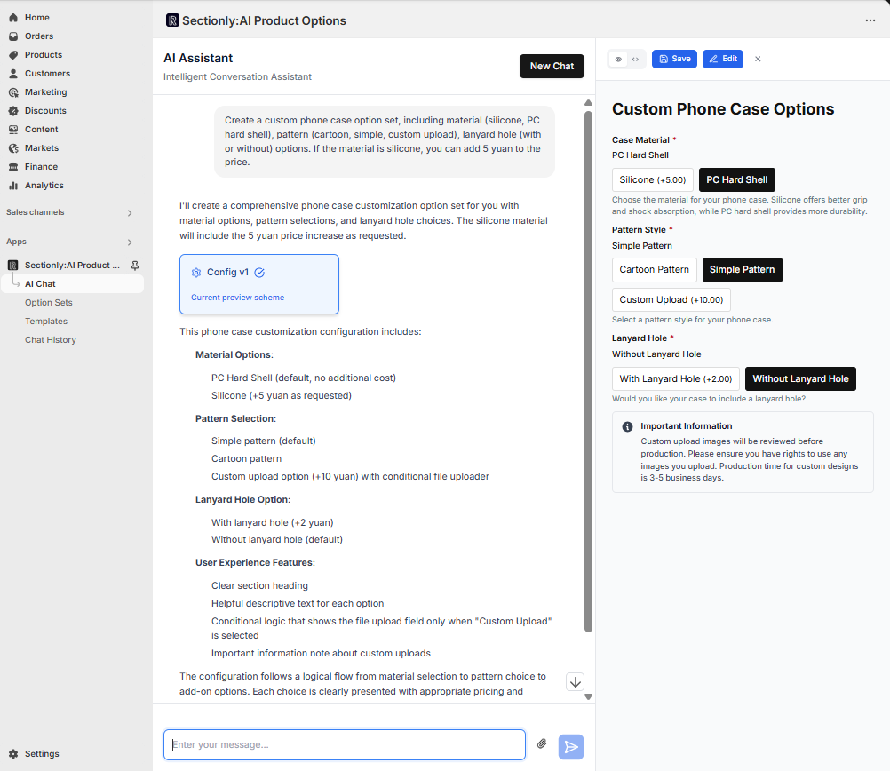

#### 继续优化

若对生成结果不满意，可补充指令优化：

**优化示例：**
```
增加'夜光效果'材质选项，PC 硬壳加价 3 元
```

AI 会基于历史对话迭代生成新配置，支持多次迭代（生成多版本，如 V1、V2）。

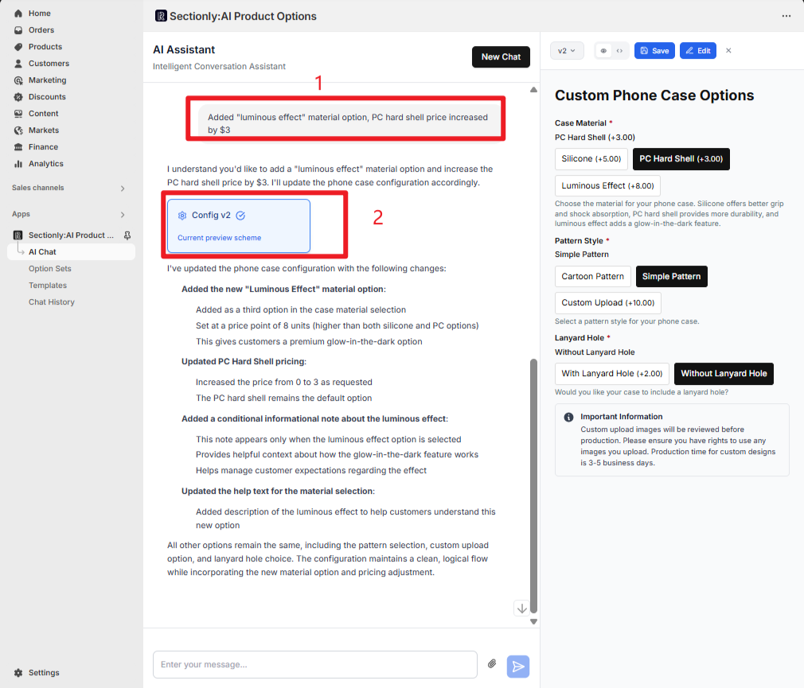

### 版本切换与对比

<Tabs>
<Tab title="左侧对话区域切换">

**操作方式：**
- 对话区留存所有历史版本卡片
- 点击不同版本（`Config v1`/`Config v2`）
- 右侧预览区会同步切换对应配置效果
- 方便对比多轮优化差异

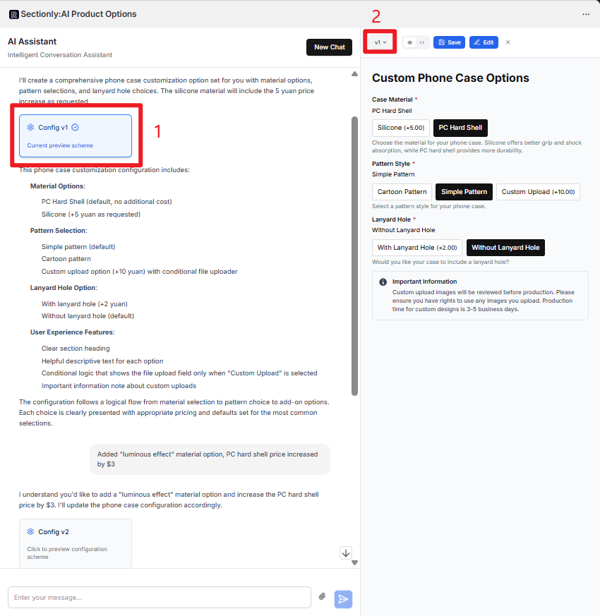

</Tab>
<Tab title="右侧下拉切换">

**操作方式：**
- 右侧预览区顶部设有版本下拉菜单（显示当前版本，如 `v2`）
- 点击可展开版本列表（含 `v1`/`v2`）
- 选择对应版本即可切换预览效果
- 与左侧对话区切换功能联动，双向同步显示状态

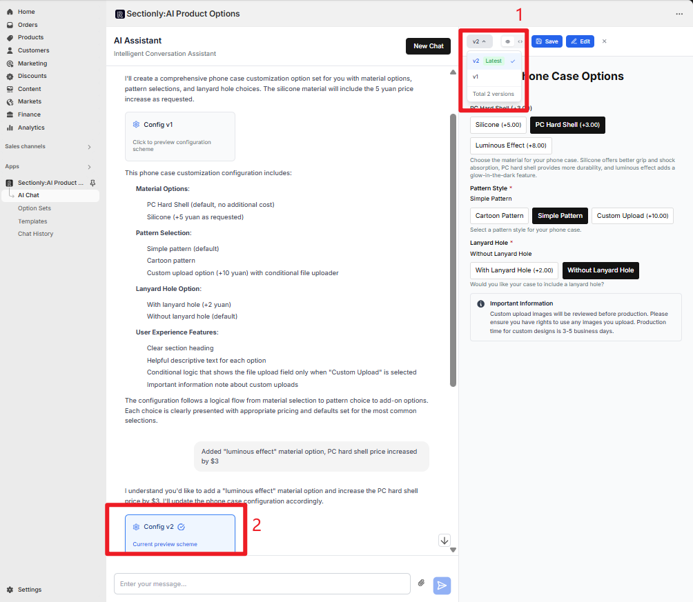

</Tab>
</Tabs>

### 对话暂停或补充需求

<AccordionGroup>
<Accordion title="暂停执行">

在 AI 执行生成或优化配置过程中，若发现发出的内容有错误，或需要补充新需求：

1. 点击输入框右侧的暂停按钮
2. AI 会立即停止当前执行流程

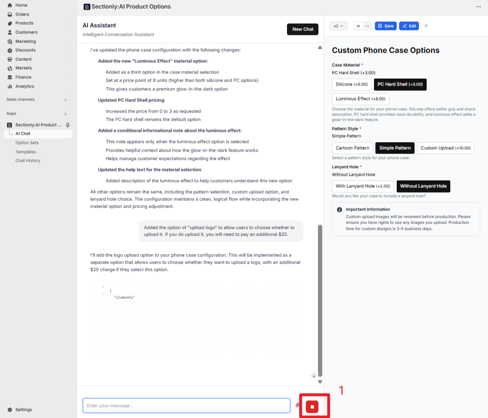

</Accordion>

<Accordion title="继续执行">

暂停后可在输入框补充新指令：

**示例：**
```
修正夜光材质价格描述，补充 logo 上传选项
```

按回车后，AI 将基于暂停时的对话上下文，结合新需求继续执行配置生成/优化，无需重新开始对话。

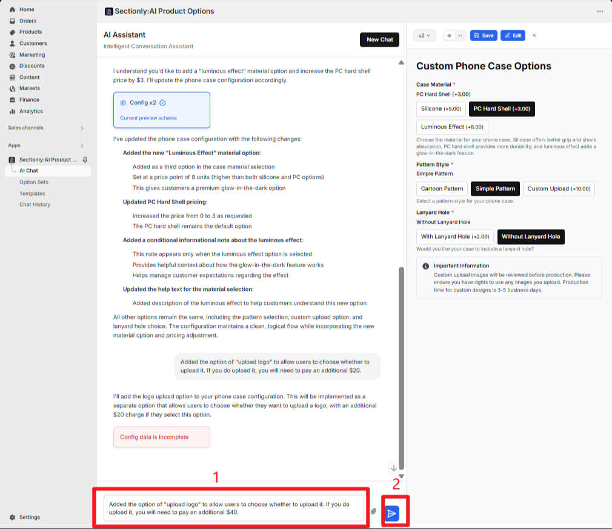

</Accordion>
</AccordionGroup>

## 配置保存

### 保存操作

<Steps>
<Step title={"确认某版本配置后，点击对话区配置卡片旁的 \"Save\" 按钮"}>
</Step>
<Step title={"弹出 \"Save Configuration\" 弹窗"}>
</Step>
<Step title={"为配置命名（默认生成含时间戳的名称，如 `AI Generated Config - 8/18/2025, 4:03:37 PM`）"}>
</Step>
<Step title={"配置会自动同步到左侧导航栏 \"Option Sets\" 列表"}>
</Step>
</Steps>

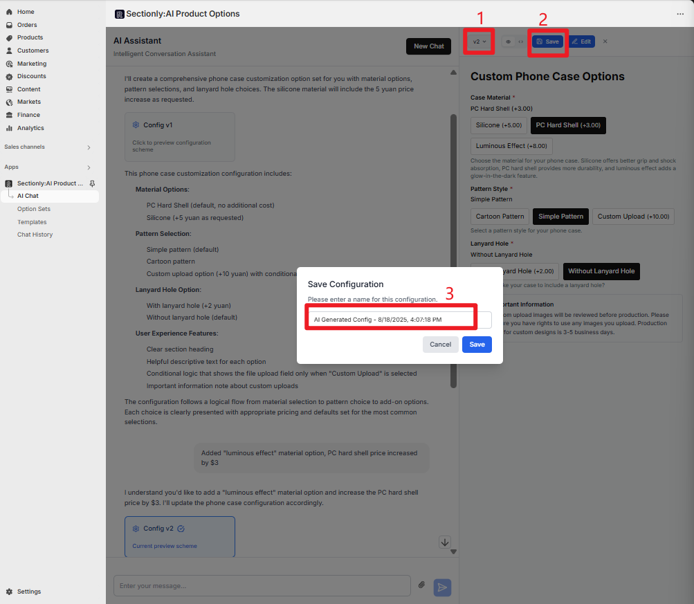

### 配置手动编辑

<Info>
保存后的配置支持手动编辑，提供更精细的控制能力。
</Info>

<Steps>
<Step title={"点击 \"Edit\" 按钮，弹出当前版本的配置弹窗"}>
</Step>
<Step title={"该界面支持手动编辑修改配置"}>
</Step>
<Step title={"完成手动编辑后："}>
- 点击界面右上角 `Save` 按钮，保存修改内容
- 点击 `Cancel` 则放弃修改，关闭编辑弹窗
</Step>
<Step title={"配置会自动同步到左侧导航栏 \"Option Sets\" 列表"}>
</Step>
</Steps>

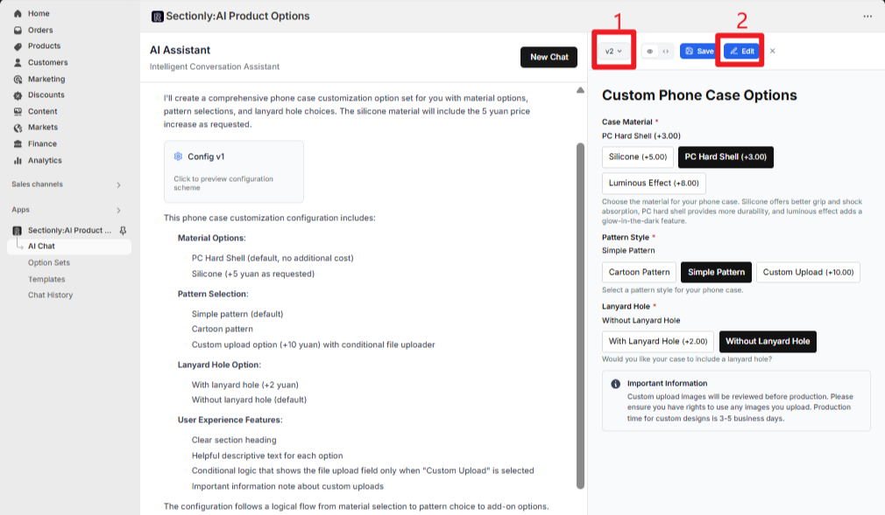

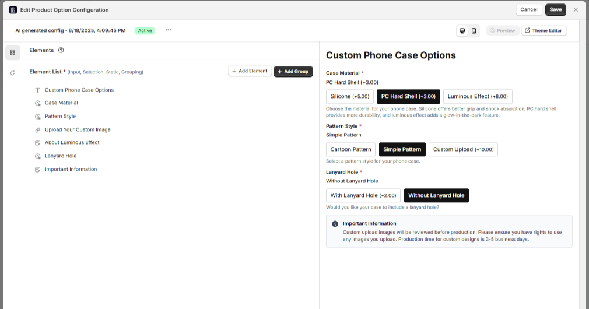

## 选项集应用产品配置

### 进入选项集列表

<Steps>
<Step title={"点击左侧导航栏 \"Option Sets\""}>
</Step>
<Step title={"找到 AI 生成并保存的选项集（如 AI Generated Config）"}>
</Step>
<Step title={"点击进入编辑页"}>
</Step>
</Steps>

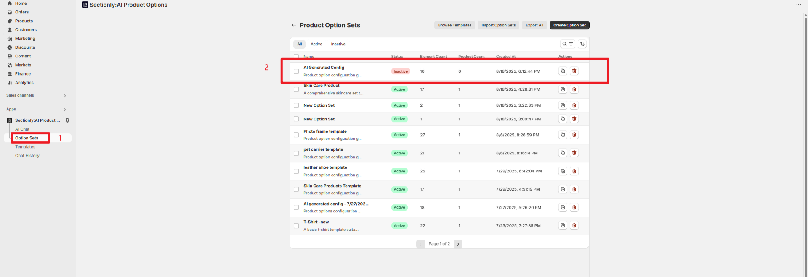

### 设置应用产品范围

<Tabs>
<Tab title="Manual Selection">

**手动选择产品**

1. 开启 "Manual Selection" 开关
2. 点击 "Click to select products"
3. 搜索并勾选目标产品（支持多选）

</Tab>
<Tab title="Apply to All Products">

**全部产品应用**

开启 "Apply to All Products" 开关，选项集自动应用到全部产品（适合通用型定制，如 "所有商品支持礼盒包装"）

</Tab>
</Tabs>

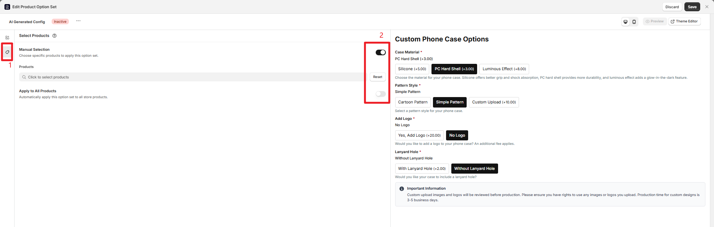

### 基础信息配置

<Steps>
<Step title={"点击 \"New Option Set\" 旁的 \"⋯\" 按钮"}>
</Step>
<Step title={"在弹出弹窗中修改选项集名称（如 \"夏季 T 恤定制\"）"}>
</Step>
<Step title={"选择状态："}>
- "Active"（生效，可应用产品）
- "Inactive"（失效，暂不应用）
</Step>
</Steps>

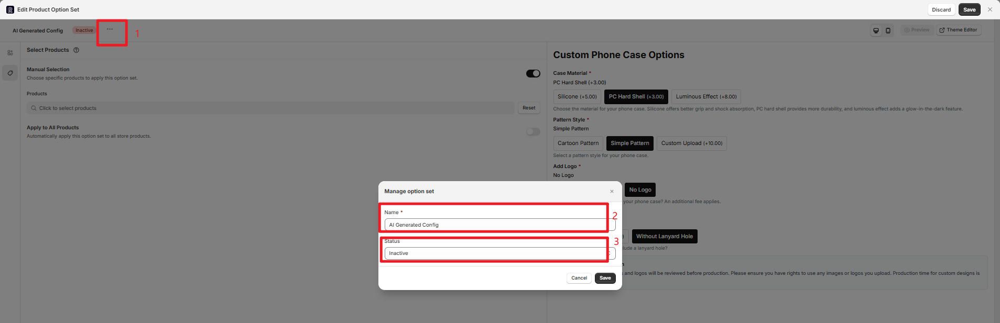

### 最终保存

<Steps>
<Step title={"点击 \"Save\" 按钮，模板配置会同步到左侧 Option Sets 列表"}>
</Step>
<Step title={"点击 \"Discard\" 按钮则放弃复用"}>
</Step>
</Steps>

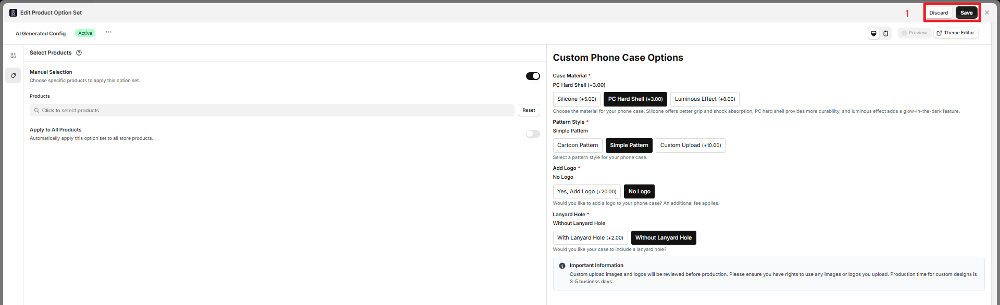

## 注意事项

<Warning>
**重要提醒**
- AI 生成的配置支持多次迭代优化
- 版本管理功能便于对比不同配置效果
- 保存后的配置可进一步手动编辑
- 建议在保存前充分测试预览效果
</Warning>

<Info>
**最佳实践**
- 提供详细的需求描述能提高 AI 生成质量
- 善用多媒体辅助（图片、文档、链接）
- 利用版本对比功能选择最佳配置
- 合理使用暂停功能避免错误生成
</Info>
