本指南将详细介绍如何在 Sectionly:AI Product Options 中手动创建产品选项集，包括元素添加、分组管理和应用设置等核心功能。

## 进入创建页面

### 导航路径

<Steps>
<Step title={"进入 App 管理后台"}>
</Step>
<Step title={"选择 \"Sectionly:AI Product Options\""}>
</Step>
<Step title={"点击 \"Option Sets\""}>
</Step>
<Step title={"点击 \"Create Option Sets\""}>
</Step>
</Steps>

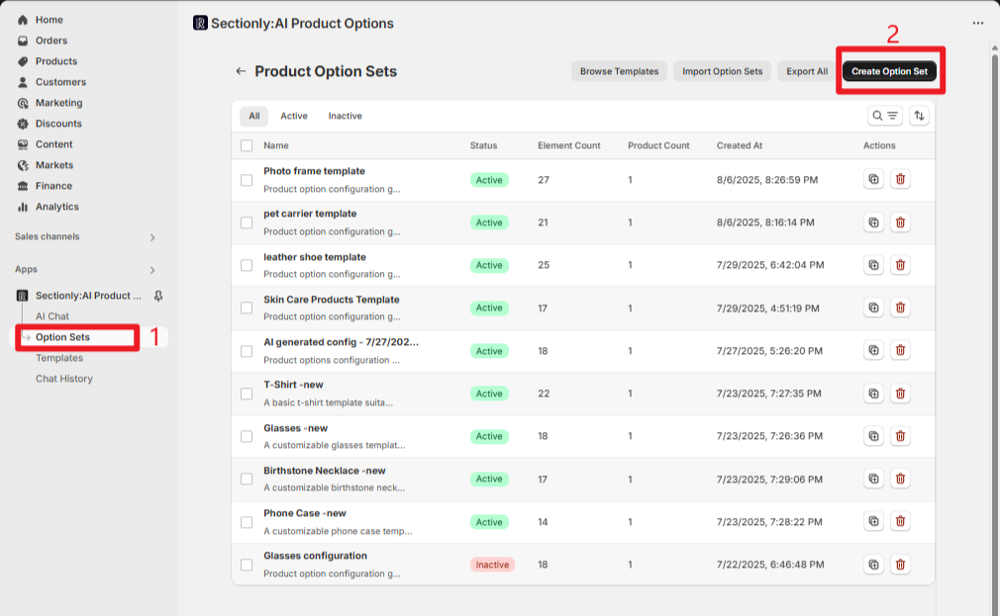

## 核心操作流程

### 添加元素

<Info>
点击 "+ Add Element" 按钮，系统会弹出元素类型选择菜单，包含 3 大类不同的元素类型供您选择。
</Info>

1. **选择元素类型**
   - 从弹出菜单中选择所需的元素类型
   - 例如：点击 "Text Input"，元素会立即添加到列表中
   - 右侧预览区域会实时显示已添加的元素效果

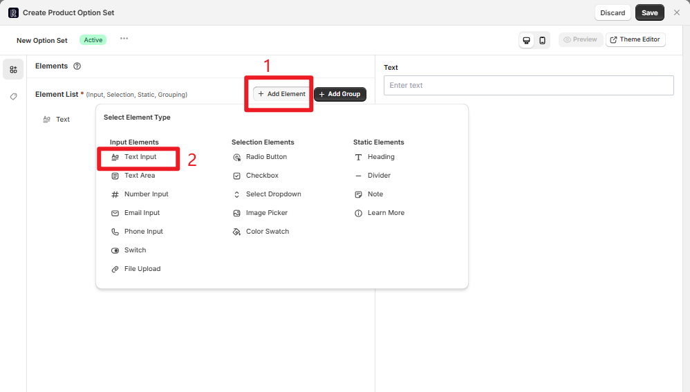

2. **配置元素属性**
   - 根据个人需求配置每个元素的配置项
   - 详细的配置项说明请参考相关文档

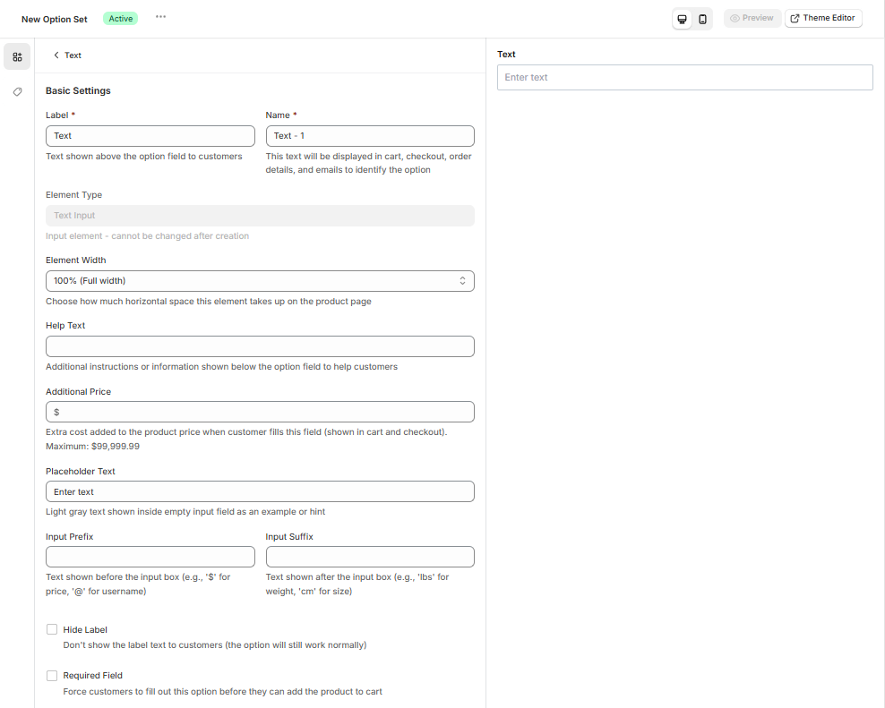

### 分组管理

分组功能可以帮助您更好地组织相关元素，优化前端展示逻辑。

<Steps>
<Step title={"点击 \"Add Group\" 添加分组元素"}>
</Step>
<Step title={"在 \"Group Members\" 中勾选需要纳入分组的元素"}>
</Step>
<Step title={"元素会按照主列表顺序在分组中展示"}>
</Step>
</Steps>

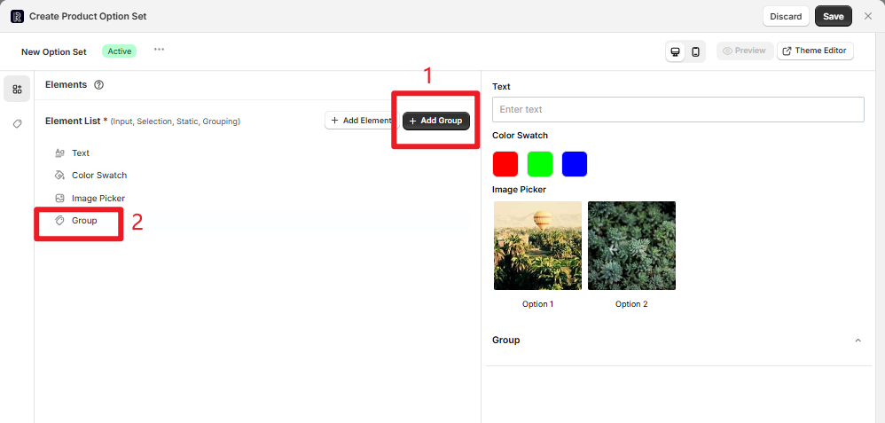

**分组示例：**
创建 "外观定制" 分组时，可以勾选已添加的 "Color Swatch" 和 "Image Picker" 元素。在前端预览时，这两个元素会归属于该分组展示。

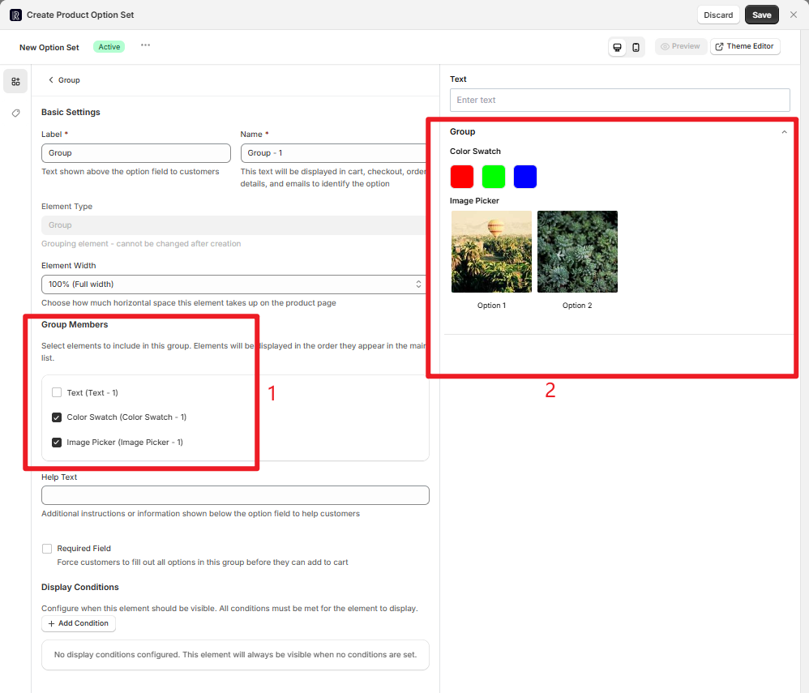

## 选项集应用与设置

### 产品应用范围

<Tabs>
<Tab title="Manual Selection">

**手动选择产品**

1. 开启 "Manual Selection" 开关
2. 点击 "Click to select products" 搜索并勾选目标产品
3. 每个产品右侧有 "Remove" 按钮，可单独移除不需要的产品
4. 点击 "Reset" 按钮可一键清空所有已选产品，重新规划应用范围

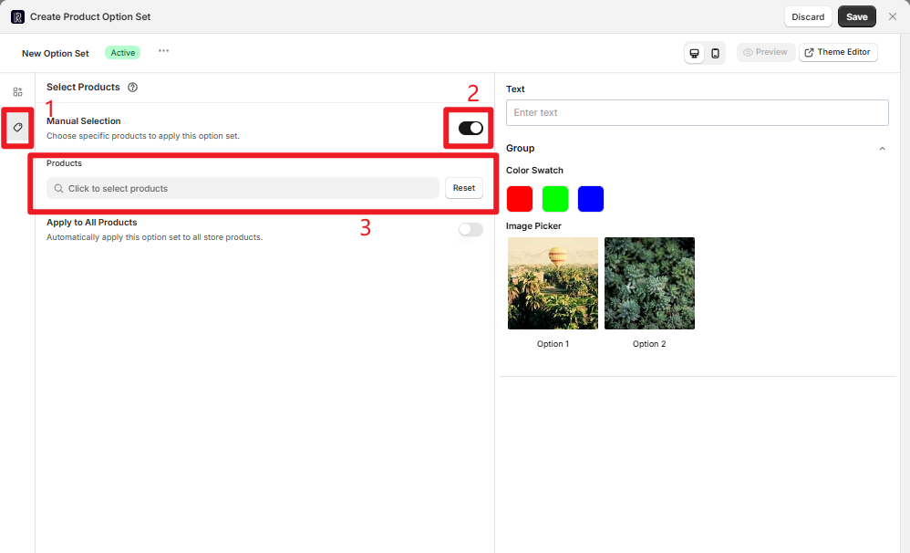

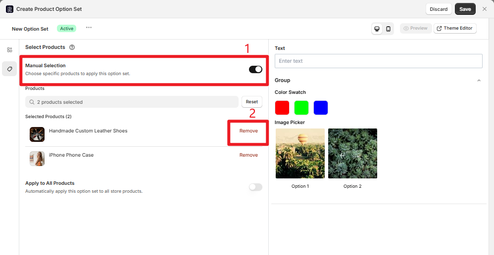

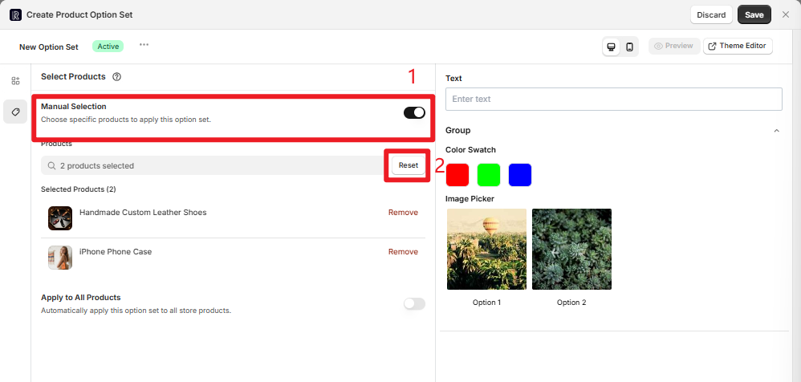

</Tab>
<Tab title="Apply to All Products">

**应用到所有产品**

开启 "Apply to All Products" 开关，选项集将一键应用到全部产品，适合通用型定制需求。

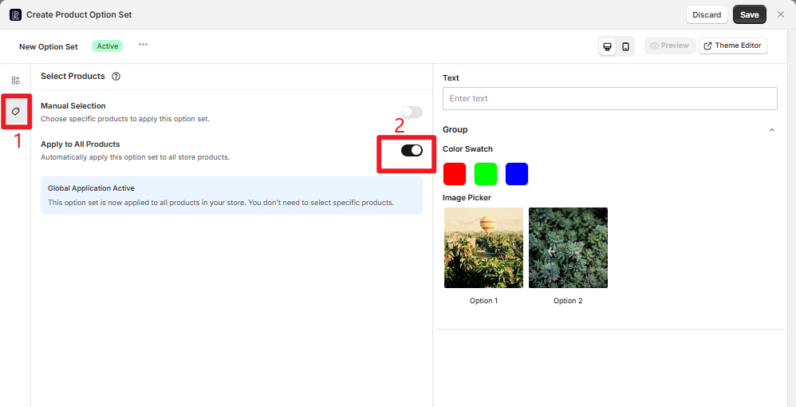

</Tab>
</Tabs>

### 基础信息配置

<Steps>
<Step title={"点击 \"New Option Set\" 旁的 \"⋯\" 按钮"}>
</Step>
<Step title={"在弹出窗口中修改选项集名称（如 \"夏季 T 恤定制\"）"}>
</Step>
<Step title={"选择状态："}>
- "Active"：生效，可应用到产品
- "Inactive"：失效，暂不应用
</Step>
</Steps>

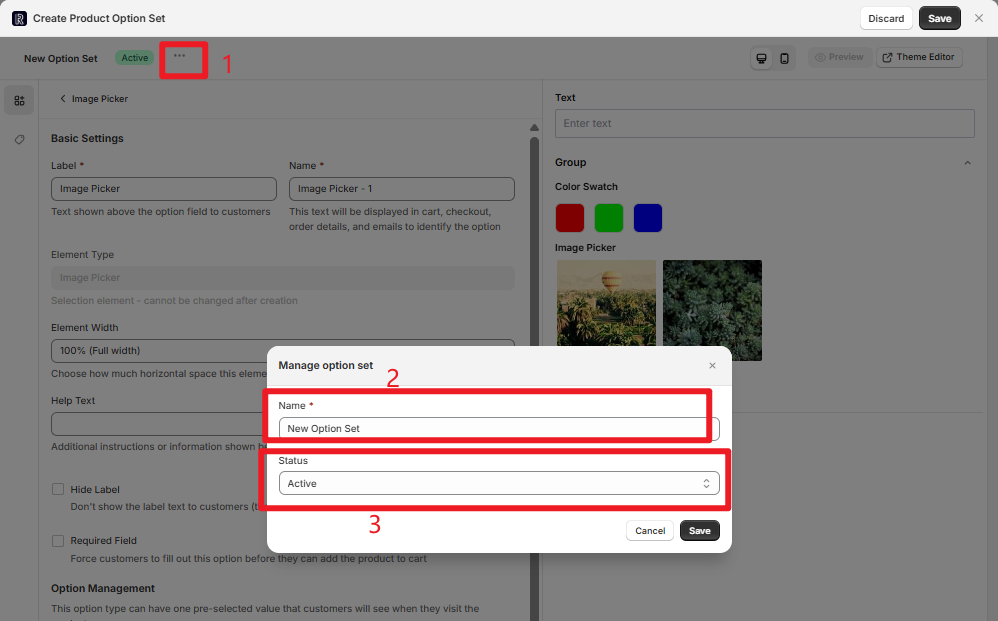

## 顶部操作按钮

<AccordionGroup>
<Accordion title="Discard（放弃）">
放弃当前配置，关闭弹窗且不保存任何更改。

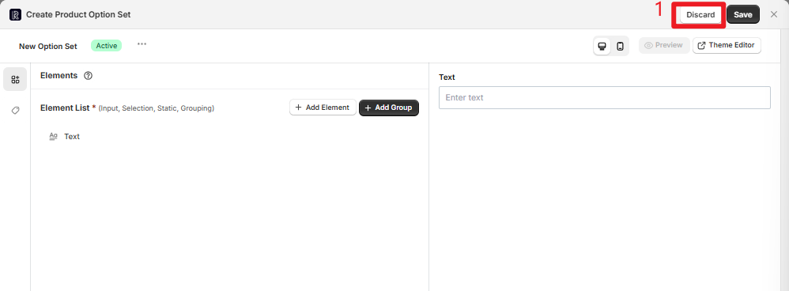
</Accordion>

<Accordion title="Save（保存）">
保存当前配置但不关闭配置弹窗，可以继续进行调整。

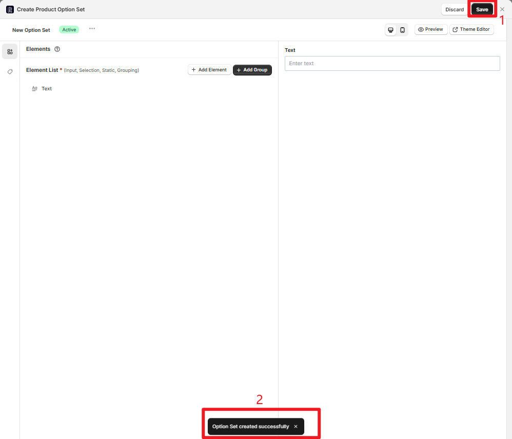
</Accordion>

<Accordion title="预览模式">
**桌面端预览：**
点击 PC 端图标，右侧预览区展示电脑端布局效果。

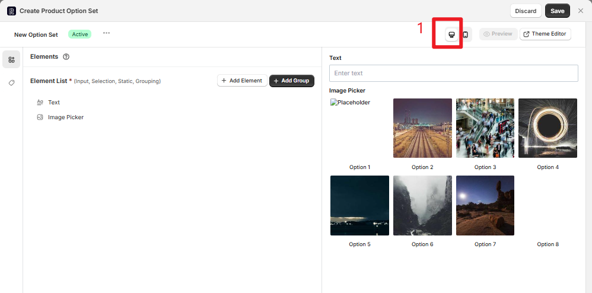

**移动端预览：**
点击 M 端图标，预览区模拟移动设备界面排版。

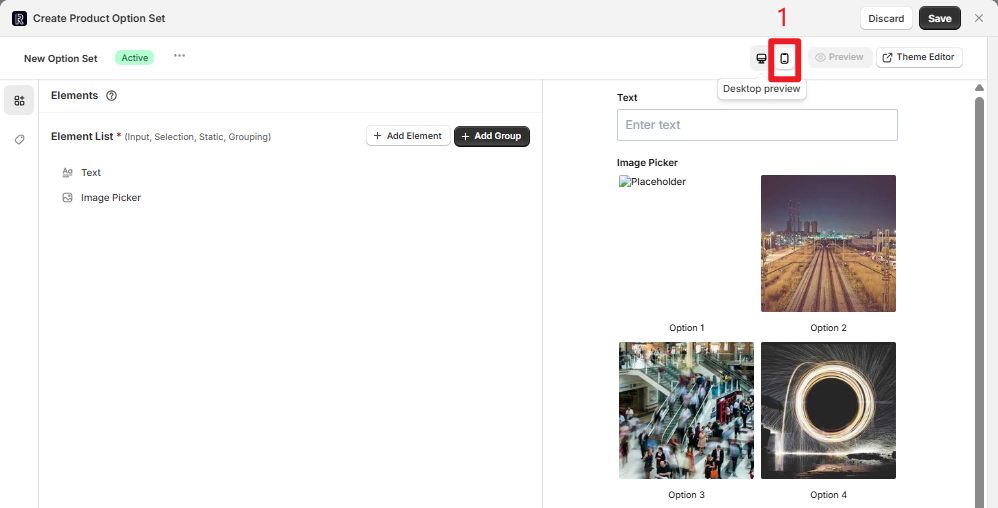
</Accordion>

<Accordion title="Theme Editor（主题编辑器）">
如果尚未在主题编辑器中配置 App Block 嵌入等展示设置，或需要精细调整选项集在店铺主题中的显示（如位置、样式适配），点击 "Theme Editor" 按钮可快速跳转至 Shopify 线上主题编辑器。

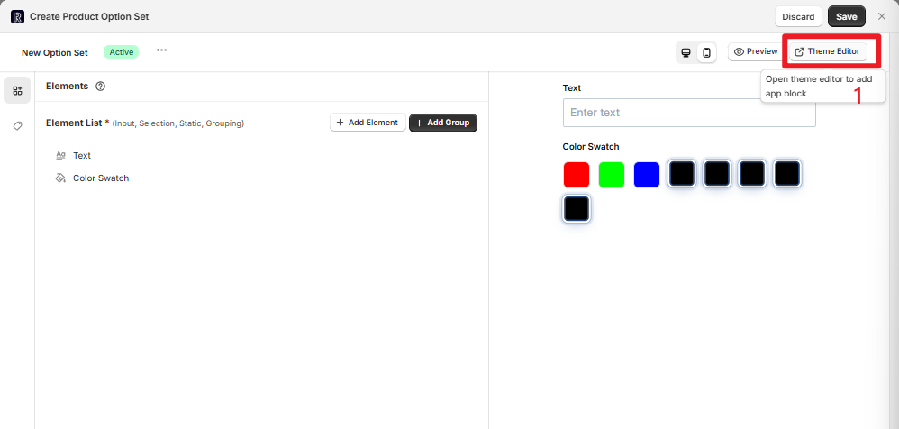
</Accordion>

<Accordion title="Preview（预览验证）">
点击 "Preview" 按钮，弹出专属弹窗，仅显示当前配置实际应用的产品。点击产品旁的 "Preview" 可跳转至前端详情页验证配置效果。

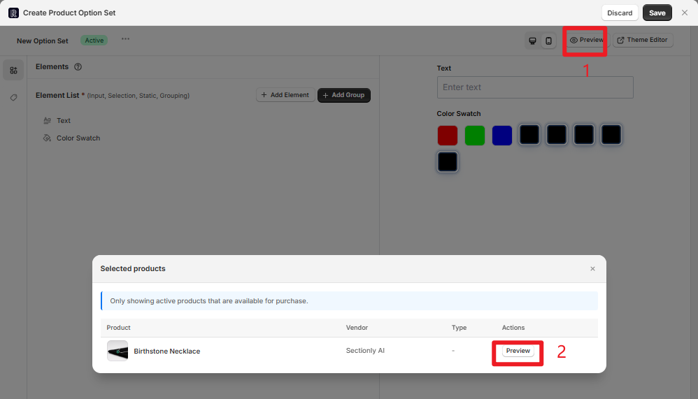
</Accordion>
</AccordionGroup>

## 注意事项

<Warning>
**重要提醒**
- 选项集创建后，状态默认为 "Active"
- 可在 "选项集列表" 中进行管理（如修改状态、复制、删除等）
- 当多个生效选项集应用产品重叠时，遵循 "精准匹配优先" 和 "最新更新为准" 的优先级规则
</Warning>
