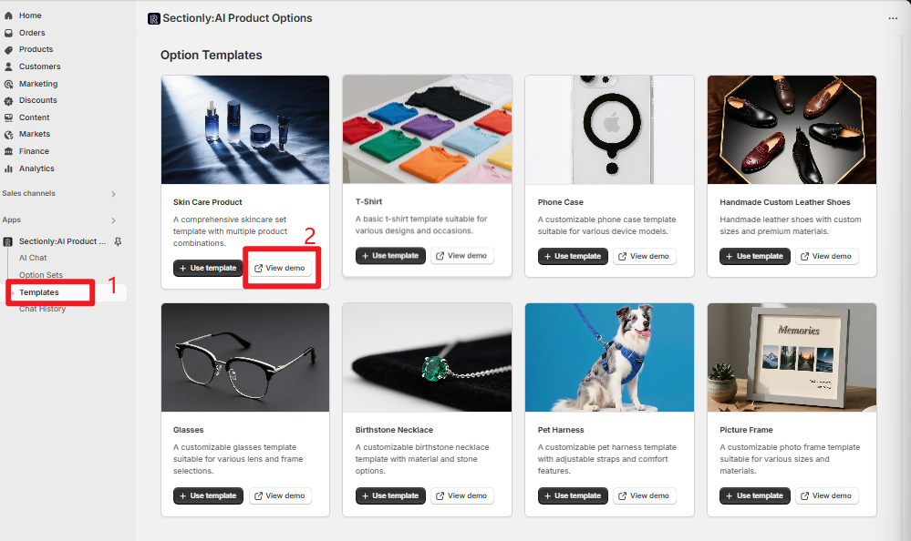
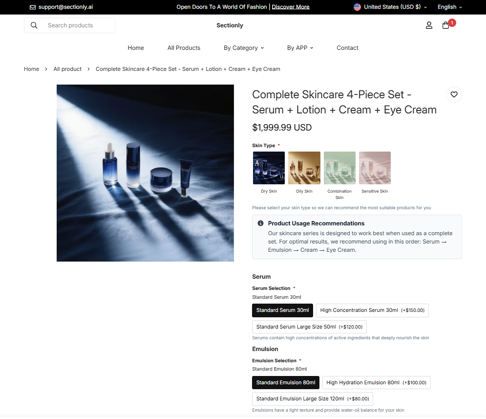
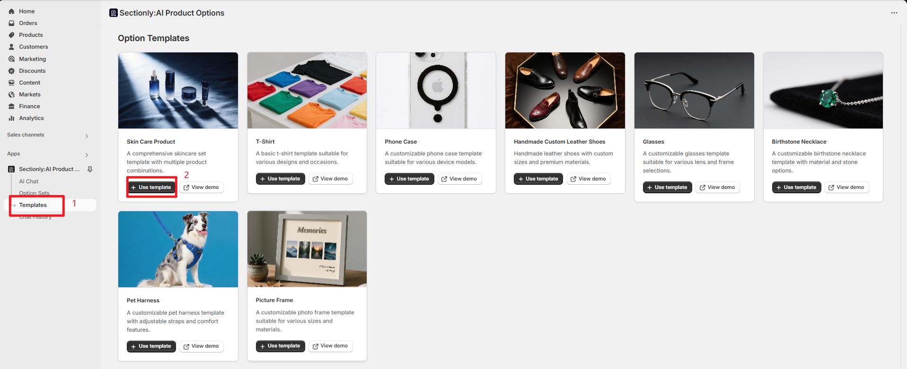
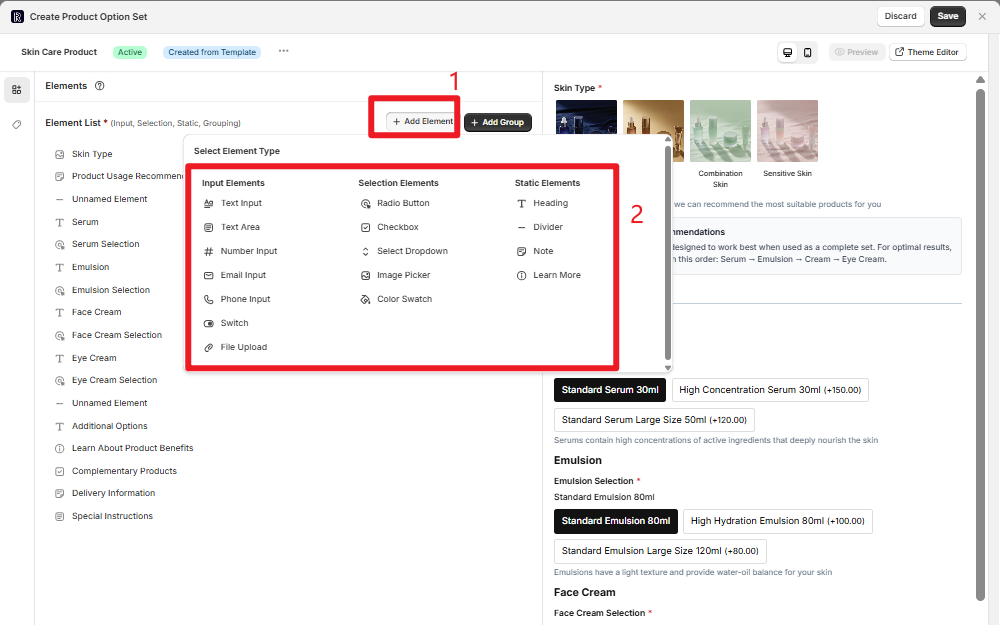
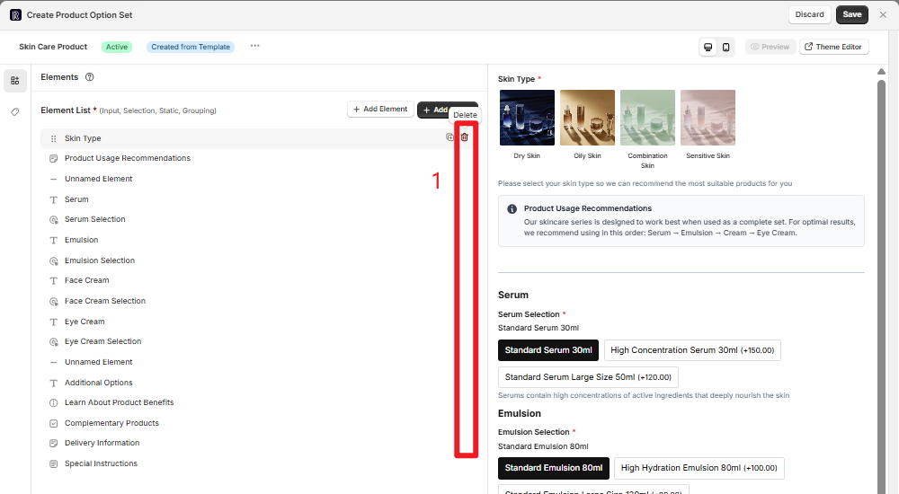
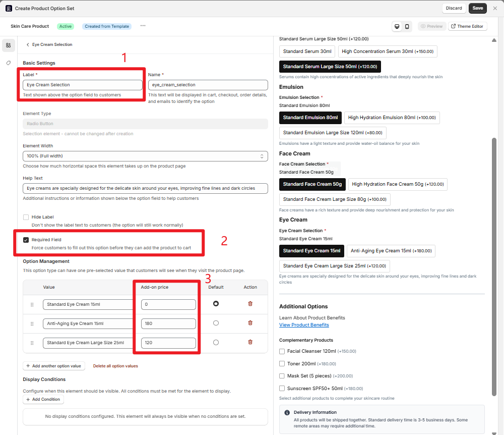
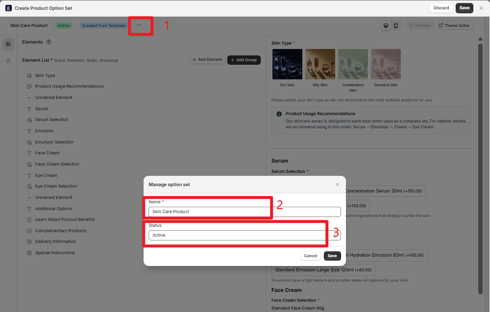
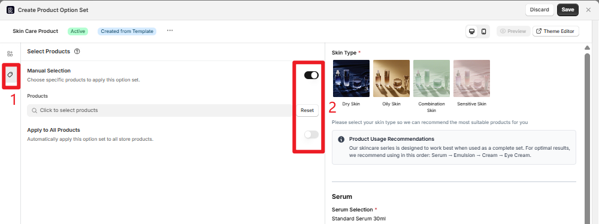
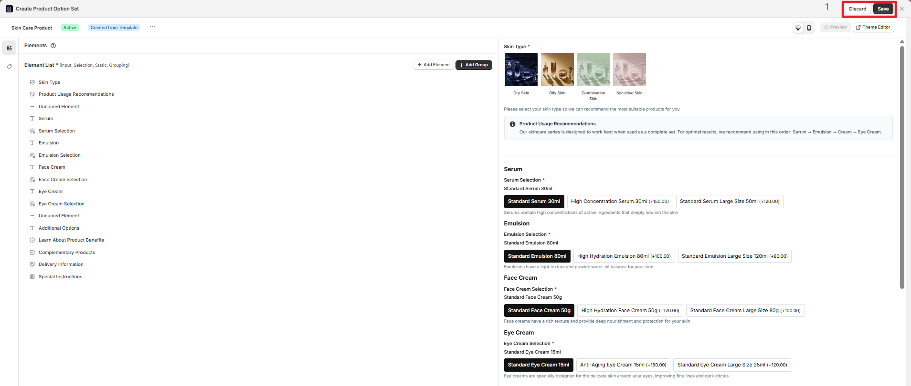

## 模板创建产品选项

通过预设模板快速创建产品选项集，无需从零开始配置。模板提供了常见行业的标准化配置，可直接使用或作为基础进行个性化调整。

## 进入模板页面

<Steps>

<Step title={"导航到模板中心"}>

按照以下路径进入模板页面：

**App → Sectionly:AI Product Options → Templates**
</Step>

</Steps>

## 核心操作流程

### 预览模板效果

在选择模板前，建议先预览模板的实际效果，了解用户在前端的定制体验。

<Info>
**预览功能**

点击 **"View demo"** 按钮可跳转到模板前端效果演示页，模拟用户下单时的完整定制流程。
</Info>

通过预览页面，你可以体验：
- 选择 T 恤颜色、尺码等基础选项
- 个性化定制选项的交互流程
- 价格计算和显示效果
- 整体用户体验流程

### 复用模板配置

确认模板符合需求后，可以直接复用模板配置并进行个性化调整。

<Steps>

<Step title={"启用模板"}>

点击 **"Use template"** 按钮，系统会自动跳转到该模板的配置页面。

</Step>

<Step title={"元素管理"}>

在配置页面可以对模板进行深度调整：

**添加新元素：**
- 点击 **"+ Add Element"** 按钮添加新的定制项
- 支持多种元素类型：文本输入、下拉选择、颜色选择器等

**删除冗余元素：**
- 对于不需要的选项，可以直接删除
- 保持选项集的简洁性，提升用户体验

</Step>

<Step title={"修改配置项"}>

对每个元素可以进行详细配置：

<Tabs>

<Tab title="基础设置">
- **标题内容**：修改选项的显示名称
- **必填字段**：设置是否为必选项
- **帮助文本**：添加选项说明
</Tab>

<Tab title="价格设置">
- **附加价格**：为特定选项设置加价
</Tab>

<Tab title="显示条件">
- **条件逻辑**：基于其他选项的选择显示/隐藏
- **依赖关系**：设置选项间的关联关系
</Tab>

</Tabs>

</Step>

</Steps>

## 基础信息配置

### 选项集设置

配置选项集的基本信息和状态：

<Tabs>

<Tab title="基础信息">
- **选项集名称**：为选项集设置一个描述性的名称
- **描述信息**：添加选项集的用途说明
- **标签分类**：便于后续管理和查找
</Tab>

<Tab title="状态管理">
- **Active**：选项集生效，在前端显示
- **Inactive**：选项集暂停，不在前端显示
</Tab>

</Tabs>

## 选项集应用与设置

选择选项集的应用范围，决定哪些产品会显示这个选项集。

<Tabs>

<Tab title="手动选择">
### Manual Selection（手动选择）

适用于特定产品的定制化需求：

1. 开启 **"Manual Selection"** 开关
2. 点击 **"Click to select products"**
3. 搜索并勾选目标产品（支持多选）
4. 确认选择的产品列表

<Info>
**使用场景**

适合需要精确控制的场景，如高端定制产品、限量版商品等。
</Info>
</Tab>

<Tab title="全部应用">
### Apply to All Products（全部产品应用）

适用于通用型定制选项：

1. 开启 **"Apply to All Products"** 开关
2. 选项集自动应用到店铺内所有产品
3. 新添加的产品也会自动包含此选项集

<Warning>
**使用场景**

适合通用服务，如"礼盒包装"、"加急配送"等所有商品都适用的选项。
</Warning>
</Tab>

</Tabs>

## 保存与管理

### 保存选项集

完成配置后，需要保存选项集以使其生效：

<Steps>

<Step title={"保存配置"}>

点击 **"Save"** 按钮保存当前配置：
- 模板配置会同步到左侧 **Option Sets** 列表
- 选项集状态变为可管理状态
- 可在产品页面看到效果
</Step>

<Step title={"放弃更改"}>

如果不满意当前配置，点击 **"Discard"** 按钮：
- 放弃当前所有更改
- 返回到模板选择页面
- 不会保存任何配置信息
</Step>

</Steps>

<Tip>
**最佳实践**

建议在保存前先使用预览功能测试选项集的效果，确保用户体验符合预期。
</Tip>

## 后续步骤

完成模板配置后，你可以：

1. **测试效果**：在产品页面查看选项集的实际显示效果
2. **继续优化**：根据实际使用情况调整选项配置
3. **复制模板**：基于当前配置创建更多变体
4. **管理状态**：随时启用或停用选项集

<Info>
**提示**

模板只是起点，你可以根据具体业务需求进行深度定制，打造独特的产品定制体验。
</Info>
