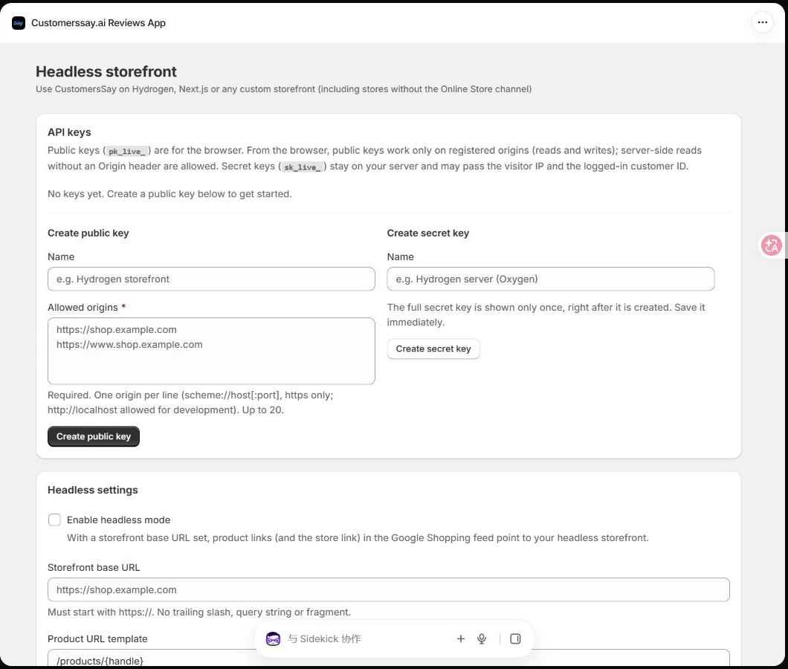
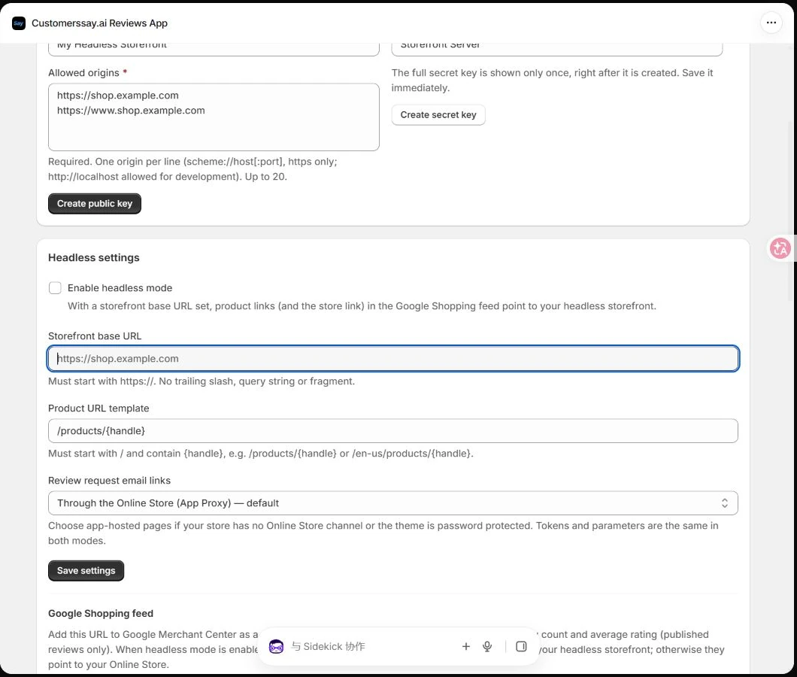

<Note>
通过本店密钥提交的评论会进入 Shopify 后台的 Customerssay 应用 → Manage Reviews，并遵循店铺的审核与发布设置。待审核评论批准后才会公开显示。
</Note>

本指南介绍如何从创建 API 密钥开始，将 CustomersSay Reviews 接入自建店面，并选择 API、自带 JS 组件或服务端渲染。

## 一 开始前需要准备什么

准备已安装正式应用的 Shopify 店铺、可部署的自建店面，以及店面的完整域名。

## 二 创建 API 密钥

打开 Shopify 后台 → 应用 → Customerssay.ai Reviews App → Headless。左侧 Create public key 用于浏览器，右侧 Create secret key 用于服务端。

<Frame caption="图 1 进入 Headless 页面后 在对应区域创建密钥">
  
</Frame>

### 创建浏览器公钥

1. 在 **Create public key** 的 Name 中输入容易识别的名称，例如 My Headless Storefront。
2. 在 **Allowed origins** 中填写真实店面域名，每行一个。示例 `https://shop.example.com` 和 `https://www.shop.example.com`；上线时替换为你的域名。
3. 点击 **Create public key**，复制以 **pk_live_** 开头的完整公钥。已有公钥可在列表中点击 Copy。
4. 把公钥放入浏览器接入配置；测试域名和正式域名需要分别登记。

Origin 是协议、主机名和可选端口的组合，不带 /products 等路径，也不带通配符。`https://shop.example.com` 与 `https://www.shop.example.com` 不相同；`http://localhost:3000` 与 `http://localhost:5173` 也不相同。生产使用 HTTPS，本地开发可以登记 `http://localhost:端口`。最多登记 20 个 Origin。

### 创建服务端私钥

1. 只有服务端读取、代提交或 SSR 接入才需要私钥。在 **Create secret key** 中填写名称，例如 Storefront Server。
2. 点击 **Create secret key**，立即复制以 **sk_live_** 开头的完整私钥。私钥明文只显示一次。
3. 保存到服务端环境变量或部署平台的 Secret 设置，完成后重新部署服务端。不要放入浏览器配置、HTML、截图或公开仓库。

这里创建的是 CustomersSay 店面 API 密钥。店铺归属由密钥决定，前端不需要 Shopify Admin access token。本文所有密钥和商品 ID 都是占位值，不能直接作为有效凭据。

## 三 配置自建店面链接

需要 Google Shopping Feed 的商品链接跳转到自建站时，在 Headless settings 勾选 Enable headless mode，填写 Storefront base URL，例如 `https://shop.example.com`，再填写 Product URL template，例如 `/products/{handle}`，最后点击 Save settings。这个设置控制链接目标；API 接入仍通过密钥鉴权。

<Frame caption="图 2 自建店面地址 商品路径模板和邀评邮件链接设置">
  
</Frame>

Storefront base URL 使用 HTTPS，不带查询参数或片段，去掉末尾斜杠。商品路径必须以 / 开始，并包含 `{handle}`；例如 `/en-us/products/{handle}`。

如果店铺没有 Online Store 渠道，或主题商店受密码保护，将 Review request email links 选择为 **App-hosted pages**，再保存。邀评和退订链接将使用应用托管页面；普通主题商店可继续使用默认 App Proxy。

## 四 选择适合的接入方式

| 方式 | 需要实现什么 | 适合场景 |
| --- | --- | --- |
| 自带 JS 组件 | 加入脚本和容器，传入公钥与商品 ID | 快速展示完整评论区 |
| 纯 API 自定义界面 | 自己实现 HTML、React、Vue 和 CSS | 已有设计系统，需要完全控制样式 |
| 服务端接入和 SSR | 私钥放在服务端，读取数据渲染首屏 | 重视首屏、SEO 或可信顾客身份 |

正式 API 基础地址为 `https://app-next.customerssay.ai/api/storefront/v1`。下面先给最快的 JS 接入，再给自定义 API 与服务端方案。

## 五 使用自带 JS 评论组件

将以下内容加入商品页。替换公钥、YOUR_STORE.myshopify.com 和 YOUR_PRODUCT_ID；商品 ID 应来自该店铺真实商品，可使用纯数字或 Shopify Product GID。配置脚本需要在 embed.js 之前执行。

```html
<link rel="stylesheet"
  href="https://app-next.customerssay.ai/api/storefront/v1/embed.css">
<script>
  window.CustomersSayConfig = {
    apiBase: 'https://app-next.customerssay.ai/api/storefront/v1',
    publicKey: 'pk_live_REPLACE_WITH_YOUR_PUBLIC_KEY',
    shop: 'YOUR_STORE.myshopify.com'
  };
</script>
<script src="https://app-next.customerssay.ai/api/storefront/v1/embed.js"
  defer></script>
<div data-customerssay-reviews
  data-product-id="YOUR_PRODUCT_ID"></div>
```

1. 把页面部署到已登记的 Origin。直接双击本地 HTML 文件的 file:// 页面不能作为正式测试域名。
2. 打开真实商品页，确认评论区、星级与写评论入口出现。没有已发布评论时会显示空状态。
3. 提交一条明确标注为测试的评论，到应用 Manage Reviews 中检查是否收到，并按店铺审核设置发布。

单页应用切换商品时，使用 window.CustomersSay.unmount(element) 清理旧实例，再用 `window.CustomersSay.mount(element, { productId })` 挂载新商品。不要保留旧商品的评论实例。

有内容安全策略 CSP 的站点，需要允许应用域名加载脚本、样式并发起请求，允许媒体域名加载图片和视频。配置脚本按框架添加实际 nonce；现成组件还需要 style-src-attr 的内联样式许可。Swiper 资源由应用域名提供。

## 六 使用 API 和自己的样式

评论展示和提交可以分开实现。以下代码用于浏览器，请从已登记域名运行。将读取和提交示例放在同一个前端 ES 模块文件中，或同一个 `<script type="module">` 中，以支持顶层 await 和共享配置。先在页面放入 `<ul id="review-list"></ul>`，再执行读取代码。返回值中的 summary.total_reviews 和 summary.average_rating 可用于你自己的评分摘要。

```javascript
const apiBase = 'https://app-next.customerssay.ai/api/storefront/v1';
const publicKey = 'pk_live_REPLACE_WITH_YOUR_PUBLIC_KEY';

async function loadReviews(productId, page = 1) {
  const url = new URL(`${apiBase}/reviews`);
  url.search = new URLSearchParams({
    product_id: productId, page: String(page), limit: '10',
  }).toString();
  const response = await fetch(url, {
    headers: {'X-CustomersSay-Key': publicKey},
    signal: AbortSignal.timeout(10000),
  });
  const data = await response.json();
  if (!response.ok || data.success === false) {
    const message = typeof data.error === 'string'
      ? data.error : data.error?.message;
    throw new Error(message || `HTTP ${response.status}`);
  }
  return data;
}

const data = await loadReviews('YOUR_PRODUCT_ID');
const list = document.querySelector('#review-list');
list.replaceChildren(...data.reviews.map(review => {
  const item = document.createElement('li');
  item.textContent = `${review.rating}/5 — ${review.content || ''}`;
  return item;
}));
```

自行添加 CSS 即可，例如给 #review-list 定义网格、给 li 定义卡片。React 和 Vue 中把响应存入状态，使用普通文本渲染正文；不要把用户评论直接拼成未经处理的 HTML。根据 pagination.hasNextPage 与 totalPages 实现翻页。商品评论星级筛选参数是 rating_filter，不是 rating。

### 提交评论

商品评论提交使用 FormData，不是 JSON。不要手工设置 Content-Type，浏览器会生成 multipart boundary。必填项以店铺表单设置为准；评分必须为 1 到 5 的整数。

```javascript
async function submitReview({productId, email, nickname, rating, content}) {
  const form = new FormData();
  form.set('productId', productId);
  form.set('email', email);
  form.set('nickname', nickname);
  form.set('rating', String(rating));
  form.set('content', content);

  const response = await fetch(`${apiBase}/reviews`, {
    method: 'POST',
    headers: {'X-CustomersSay-Key': publicKey},
    body: form,
  });
  const data = await response.json();
  if (!response.ok || data.success === false) {
    throw new Error(typeof data.error === 'string'
      ? data.error : data.error?.message || 'Review submission failed');
  }
  return data;
}
```

成功后显示提交结果并清理表单。评论可能需要审核；收到成功响应不代表立即公开。公钥提交不会自动获得 Verified purchase 徽标。当前接口没有 B2B 那种 Idempotency-Key 契约；网络超时后不要无提示自动重复提交，先提示用户核对或稍后重试。

### 上传图片或视频

1. 用 FormData 向 POST /media-upload?productId=YOUR_PRODUCT_ID 上传 file 和 type（image 或 video），请求带 X-CustomersSay-Key。
2. 从响应 file 中读取 url、type、thumbnailUrl 和 tempId；同一条评论的后续文件沿用 tempId。
3. 提交评论时，把预上传结果依次加入 mediaUrls[]、mediaTypes[]、mediaThumbnails[]。图片的 thumbnailUrl 为空时传空字符串，保持数组顺序一致。

前端先校验：每张图片不超过 2 MB，每个视频不超过 20 MB；每条评论最多 6 张图片和 1 个视频，媒体累计不超过 30 MB。413 表示请求体过大，不要原样重试。现成 JS 组件已经处理选择和上传流程。

## 七 在服务端接入和渲染首屏

在 Hydrogen 的服务端 loader、Next.js 服务端路由或其他后端中调用 API。私钥只从服务端 Secret 读取，不要放入 PUBLIC 或 NEXT_PUBLIC 变量，也不要作为 loader 返回值或组件 prop 返回给浏览器。下面是可放入 .server.js 模块的通用辅助函数。

```javascript
// Server only. Call this helper from your existing loader or server route.
export async function loadServerReviews({
  apiBase, secretKey, productId, visitorIp, userAgent,
}) {
  const url = new URL(`${apiBase}/reviews`);
  url.searchParams.set('product_id', productId);
  const headers = new Headers({Authorization: `Bearer ${secretKey}`});
  if (visitorIp) headers.set('X-CustomersSay-Client-IP', visitorIp);
  if (userAgent) headers.set('X-CustomersSay-Client-UA', userAgent);
  const response = await fetch(url, {
    headers, signal: AbortSignal.timeout(10000),
  });
  if (!response.ok) throw new Error(`Reviews API: ${response.status}`);
  return response.json();
}
```

服务端把返回的 reviews、summary、pagination 渲染成页面；只把需要公开的数据传给客户端。需要 SEO 时额外读取 /json-ld，并与商品页现有 Product JSON-LD 合并，避免重复输出冲突的 Product 节点。

服务端代提交同样向 /reviews 发送 FormData，改用 Authorization: Bearer 私钥。私钥请求不能携带浏览器 Origin。自己的转发路由应验证来源和请求内容，固定 API 目标，并采取 CSRF 和限流保护。

访客 IP 必须来自部署平台或你控制的可信代理。转发 X-CustomersSay-Client-IP 和访客 User-Agent 对应的 X-CustomersSay-Client-UA，可正确区分访客限流及点赞状态。需要自动验证购买时，服务端必须先确认已登录顾客身份，再传 X-CustomersSay-Customer-Id；不能直接信任浏览器提交的顾客 ID。公钥写入不自动验证购买。

可选 React 组件包 @customerssay/react 提供评论区与服务端辅助函数，目前没有发布到公共 npm。需要向 CustomersSay 支持获取源码或安装包，不能直接假设 npm install @customerssay/react 可用。

## 八 常用接口与错误排查

| 接口 | 用途 |
| --- | --- |
| `GET /reviews` | 商品评论、分页与评分摘要 |
| `GET /rating-summary` | 评分汇总 |
| `GET /questions`、`POST /questions` | 商品问答 |
| `GET /store-reviews`、`POST /store-reviews` | 店铺评论 |
| `GET /widget-settings` | 表单和组件设置 |
| `GET /json-ld` | 商品评论结构化数据 |
| `POST /media-upload` | 商品评论媒体预上传 |

| 现象 | 检查方法 |
| --- | --- |
| `401` | 检查密钥是否完整、已撤销，或店铺是否已卸载应用 |
| `403` 或 CORS 拦截 | 核对真实 Origin 和端口是否与允许列表完全一致，检查是否误用私钥 |
| `400` | 检查商品 ID、评分、邮箱及必填字段 |
| `404` 商品不存在 | 确认商品属于创建密钥的同一店铺 |
| `429` | 遵循 `Retry-After` 给出等待提示，避免连续重试 |
| 提交成功但前台不可见 | 到 Manage Reviews 检查审核与发布状态 |
| 评论串到别的商品 | 检查商品 ID 与单页应用切换时的实例清理 |

当前基础限流按密钥和访客 IP 区分：读 120 次每分钟，写 20 次每分钟，各业务接口还有单独限制。私钥 SSR 若不转发可信访客 IP，会让访客共用服务端出口 IP 的额度。请求超时、5xx 或 429 时展示可恢复的错误；不要将读取失败展示为“0 条评论”。

## 九 更换密钥与上线验收

1. 先创建新密钥并登记正式域名，更新前端或服务端配置，部署并确认读写成功。
2. 回到 API keys，对旧公钥可使用 Edit origins 调整允许域名；停用旧密钥时点击 Revoke 并确认。私钥遗失时创建新密钥。
3. 撤销后旧密钥立即不可用；应用卸载后原密钥也会失效，重装应用后需要重新创建并更新配置。

- 用真实正式域名检查桌面和手机评论区，确认不会横向溢出。
- 检查空评论 多页数据 1 到 5 星筛选以及审核未发布状态。
- 验证一次评论和图片上传，保留或清理测试样例。
- 检查页面源码与浏览器网络请求，确保没有 sk_live_ 私钥。
- 验证更换密钥后新配置可用，并对 403 429 和服务故障显示明确提示。

完整接口契约：[Storefront API v1 完整契约](https://app-next.customerssay.ai/headless/docs)

[React 和服务端组件说明](https://app-next.customerssay.ai/headless/docs/react)

最后更新：2026 年 11 月 11 日。截图使用演示店铺；请替换示例域名、密钥、商品及变体 ID。
